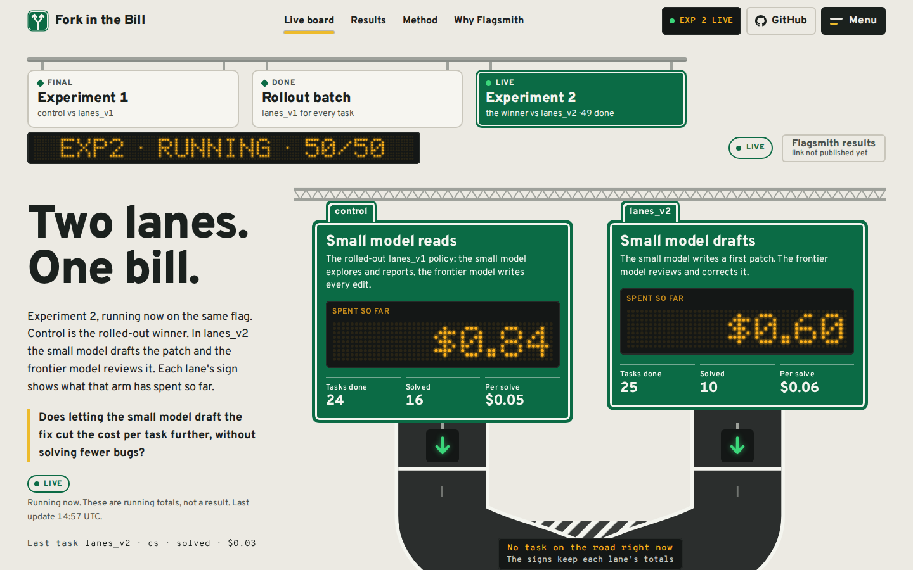
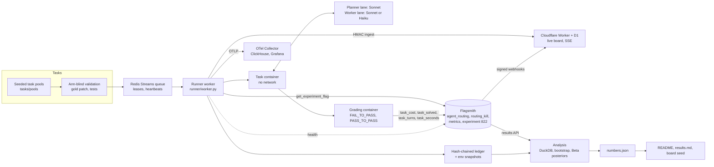

# Fork in the Bill

A pre-registered Flagsmith experiment on a coding agent's model routing: does handing the agent's grunt work to a small model cut the dollars spent per solved task?

[](https://github.com/Prashant-thakur77/fork-in-the-bill/actions/workflows/ci.yml)
[](LICENSE)
[](https://forkbill.prashantthakur.dev)

**Read it:** [paper (PDF)](docs/paper.pdf) · [slide deck (PDF)](docs/deck.pdf) · [live site](https://forkbill.prashantthakur.dev) · [full results](analysis/results.md)


Result in one line: with the delegate lane on Haiku (`lanes_v1`), the agent spent <!--n:exp1.arms.lanes_v1.cost_per_solve:usd4-->$0.0837<!--/n--> per solved task against <!--n:exp1.arms.control.cost_per_solve:usd4-->$0.1753<!--/n--> for all-Sonnet `control` (<!--n:exp1.delta.cost_per_solve_pct:pct1-->−52.2%<!--/n-->), measured on <!--n:exp1.arms.control.n_analysed:int-->76<!--/n--> control and <!--n:exp1.arms.lanes_v1.n_analysed:int-->69<!--/n--> lanes_v1 real SWE-bench-Live tasks. Shipped by the pre-registered rule: <!--n:exp1.decision.ship:str-->lanes_v1<!--/n-->.

> Status: experiment 1 is complete, decided and rolled out on the same flag. Experiment 2 runs next; its section fills in from `analysis/out/numbers.json` when it ends.

## Contents

- [The problem](#the-problem)
- [Hypothesis and pre-registration](#hypothesis-and-pre-registration)
- [How Flagsmith is used](#how-flagsmith-is-used)
- [Results](#results)
- [Integrity and how to verify](#integrity-and-how-to-verify)
- [Architecture](#architecture)
- [Setup](#setup)
- [Use the kit on your own agent](#use-the-kit-on-your-own-agent)
- [Limits](#limits)
- [Repo map](#repo-map)
- [Licence](#licence)

## The problem

A coding agent spends most of its tokens on work that needs little judgement: searching a repository, reading long files, running a test suite and reading the log. If that work runs on the same frontier model that plans the fix, the bill for the cheap work is paid at the frontier price.

The price gap is large. In [`harness/pricing.json`](harness/pricing.json) (copied from the [provider's pricing page](https://platform.claude.com/docs/en/about-claude/pricing) on 2026-11-27), Claude Sonnet 5.5 costs $2 per million input tokens and $10 per million output tokens, and Claude Haiku 5.5 costs $0.10 and $0.50, a 20x difference. In this project's own pilot ([`prereg/pilot-report.md`](prereg/pilot-report.md)), the delegate lane accounted for 61% of the all-Sonnet arm's cost.

Moving that lane to the small model is the obvious saving. The open question is whether the agent then solves fewer tasks, so that each solved task costs the same or more. A routing claim measured on someone else's benchmark doesn't answer that for your own work. A controlled experiment on real tasks, with the arm chosen by something other than the person running it, does.

## Hypothesis and pre-registration

The hypothesis, verbatim from [`prereg/experiment-1.md`](prereg/experiment-1.md) and pasted unchanged into the Flagsmith experiment's `hypothesis` field by [`flagsmith/create_experiment.sh`](flagsmith/create_experiment.sh):

> Routing the agent's delegate lane to Claude Haiku 5.5 instead of Claude Sonnet 5.5 (variation lanes_v1) lowers the mean dollar cost per task (task_cost), while the solve rate (task_solved) drops by no more than 20 percentage points. Units are real SWE-bench-Live tasks created after the models' training cutoff, one Flagsmith identity per task.

The two arms differ in one field of the flag value, `delegate.model`:

| Variation key | Planner (main lane) | Worker (delegate lane) |
|---|---|---|
| `control` (the flag's own value) | `claude-sonnet-5-5` | `claude-sonnet-5-5` |
| `lanes_v1` | `claude-sonnet-5-5` | `claude-haiku-5-5` |

Prompts, tools, tool order, effort per lane, token limits and the per-task caps (40 planner turns, $0.60, 1200 seconds of agent time) are identical. `RoutingPolicy.clean_ab_diff` checks this, and [`flagsmith/setup.sh`](flagsmith/setup.sh) refuses to create a variant that differs in anything else ([D2](DECISIONS.md#d2-no-temperature-arms-share-effort-and-thinking-settings-instead)).

Decision rule, fixed before the first task: ship `lanes_v1` only if all three hold.

1. Flagsmith reports a chance to beat control of at least 95% on `task_cost`.
2. Our Beta(1,1) posterior gives P(Δsolve > −m) ≥ 0.90, with m = 20 percentage points.
3. Flagsmith does not report `task_solved` as losing (chance to beat control below 5%).

Otherwise `control` stays and the reason is published. There is no early stopping; the run ends when every task is done, excluded or invalid.

### Registration record

| | Value |
|---|---|
| Pre-registration file | [`prereg/experiment-1.md`](prereg/experiment-1.md) |
| SHA-256 | `44d715bd6bd7f8580e8bb1950a21ea852dfea4daaf040c84009f391bf56e19c2` ([`prereg/HASHES.txt`](prereg/HASHES.txt)) |
| Git tag | `prereg-exp1` (annotated, on commit `c0856c6`) |
| Commit time | 2026-11-26 22:57:35 UTC |
| CI run on that commit | [45908009314](https://github.com/Prashant-thakur77/fork-in-the-bill/actions/runs/45908009314), created 22:57:42 UTC, passed |
| Flagsmith experiment | 822, started 2026-11-26 23:02:34 UTC ([`PROGRESS.md`](PROGRESS.md)) |

The CI run shows the registration was on GitHub about five minutes before the experiment started, and no task can run before the experiment starts. The tag is annotated but not signed; no signing key was available.

### Amendment 1

[`prereg/experiment-1-amendment-1.md`](prereg/experiment-1-amendment-1.md) (SHA-256 `f54a0cbbf415237a8c4fed55817e4d0d8055e6da8cde2bb2e146fb7bc1cc63c6`, tag `prereg-exp1-amend1`, commit `3b00eca` at 23:14:42 UTC, [CI run 45909781252](https://github.com/Prashant-thakur77/fork-in-the-bill/actions/runs/45909781252)) was written after the experiment had started. Flagsmith shows no inference for a metric until each variant has 50 identities, and the fresh pool was expected to give about 43 per arm, so rule 1 could never have passed. The original registration missed this.

The amendment adds the next 80 pre-cutoff tasks (created 2026-03-01 to 2026-06-30, same stratum, same seeded order) as `tasks/pools/exp1b.jsonl.gz` ([ids](tasks/pools/exp1b.txt)). When it was written, three tasks had finished and the author had seen only exposure and event counts, no result per arm and no cost. The arms, flag values, caps, metrics, margin, decision rule and stopping rule are unchanged. The fresh and pre-cutoff tiers are reported separately as a secondary analysis that does not enter the decision. See [D22](DECISIONS.md#d22-experiment-1-grows-by-amendment-to-clear-flagsmiths-50-per-variant-floor).

## How Flagsmith is used

Flagsmith decides which arm every task runs, records the exposure, receives the outcome events and computes the verdict the decision rule reads. The runner never picks an arm.


### Flags, variants and keys

| Flag | Type | Value | Id |
|---|---|---|---|
| `agent_routing` | multivariate | [`flagsmith/policies/control.json`](flagsmith/policies/control.json) | 306193 |
| `agent_routing` variant `lanes_v1` | keyed variant | [`flagsmith/policies/lanes_v1.json`](flagsmith/policies/lanes_v1.json) | option 37431 |
| `routing_kill` | boolean, off | none | 306194 |

The flag value is the whole routing policy as JSON (models per lane, token limits, caps, prompt variant), validated against a schema on every read. Ids are recorded in [`flagsmith/ids.json`](flagsmith/ids.json).

### Identities and traits

One task is one identity: `swelive:<instance_id>` ([`harness/schema.py`](harness/schema.py)). The runner sends the traits `repo`, `language`, `created_month`, `gold_files` and `gold_lines` ([`runner/worker.py`](runner/worker.py), `traits_for`). Exposures and events use the same identifier, which is how Flagsmith joins them.

### The exposure point

[`harness/policy.py`](harness/policy.py) `assign()` runs once per task, called from [`runner/worker.py:121`](runner/worker.py#L121):

- line 86 reads `routing_kill` with `get_identity_flags`, which records no exposure;
- line 91 calls `get_experiment_flag("agent_routing", identifier=..., traits=...)`, which records the exposure;
- line 94 flushes it at once, because the Python SDK drops the oldest buffered event when a second one arrives before the first is sent ([D9](DECISIONS.md#d9-flush-after-every-exposure-and-event)).

An invalid flag value fails closed to the control policy and is logged.

### Metrics and events

[`harness/events.py`](harness/events.py) sends these after grading, one flush per event. Definitions are in [`flagsmith/metrics.json`](flagsmith/metrics.json).

| Metric | Aggregation | Direction | Event value | Sent | Role |
|---|---|---|---|---|---|
| `task_cost` (737) | mean | down | US dollars | every exposed task, including capped and failed ones | primary |
| `task_solved` (738) | occurrence | up | 1 | only when every FAIL_TO_PASS and PASS_TO_PASS test passes in a fresh grading container | guardrail |
| `task_turns` (739) | mean | informational | agent turns | every exposed task | secondary |
| `task_seconds` (740) | mean | informational | seconds from assignment to end of grading | every exposed task | secondary |

Flagsmith has no ratio metric, so dollars per solved task is computed in [`analysis/analyse.py`](analysis/analyse.py) as mean cost divided by solve rate and shown as arithmetic in the results.

### The experiment

[`flagsmith/experiment-1.json`](flagsmith/experiment-1.json) is the request body: all four metrics, 100% rollout, 50% to `lanes_v1` and the rest to `control`. Flagsmith implements the split as a system segment override (`experiment-822-rollout`) on the flag, and the flag is locked while the experiment runs. The results page reports lift, a 95% interval, chance to beat control and a sample-ratio check; [D12](DECISIONS.md#d12-how-flagsmith-computes-the-verdict-and-how-our-replication-differs) records how Flagsmith computes them, read from its open-source `api/experimentation/stats.py`. [`analysis/pull_results.py`](analysis/pull_results.py) refreshes and saves the raw results response under [`analysis/flagsmith/`](analysis/flagsmith/).


### Kill switch

When `routing_kill` is on, a task runs the control policy, sends no exposure and no events, and is logged to the ledger as `kill_switch` ([D5](DECISIONS.md#d5-kill-switch-tasks-carry-no-exposure)). The experiment's data never contains a task the runner forced into an arm. The prereg allows the switch for safety only and requires any use to be logged.

### End Experiment and same-flag rollout

After the decision, the experiment is ended in Flagsmith with the winning variation as the rollout decision, so the winner becomes `agent_routing`'s own value. A fresh batch ([`tasks/pools/rollout.txt`](tasks/pools/rollout.txt), 20 tasks disjoint from every other pool) then runs with `make rollout`, on the same flag and with no code change. Experiment 2 starts from that state: [`flagsmith/experiment-2.json`](flagsmith/experiment-2.json) assumes the exp1 winner is the control value and adds `lanes_v2`.

### Exact CLI v2 commands

Setup goes through the [Flagsmith CLI v2](https://docs.flagsmith.com/) only. The scripts wrap these calls and stop with Flagsmith's own error on any failure:

```sh
flagsmith login                                   # or a master API key in FLAGSMITH_API_KEY
flagsmith init --project <project-id> --environment <environment-key>

# flagsmith/setup.sh
flagsmith feature create agent_routing --value "$(cat flagsmith/policies/control.json)" --enabled \
  --description "Routing policy JSON for the agent's main and delegate lanes"
flagsmith feature variant add agent_routing --value "$(cat flagsmith/policies/lanes_v1.json)" --key lanes_v1 --weight 0
flagsmith feature create routing_kill --description "On: every task runs the control policy and records no exposure"
printf '%s' "$METRIC_BODY" | flagsmith api api/v1/environments/<env>/experiment-metrics/ -X POST --input -

# flagsmith/create_experiment.sh and start_experiment.sh
printf '%s' "$BODY" | flagsmith api api/v1/environments/<env>/experiments/ -X POST --input -
flagsmith api api/v1/environments/<env>/experiments/<id>/start/ -X POST

# analysis/pull_results.py
flagsmith api api/v1/environments/<env>/experiments/<id>/results/refresh/ --method POST
flagsmith api api/v1/environments/<env>/experiments/<id>/results/

# integrity/snapshot_env.py
flagsmith environment document --no-input

# ending an experiment (the form printed by flagsmith/smoke_test.sh)
flagsmith api api/v1/environments/<env>/experiments/<id>/complete/ -X POST -F rollout_decision=<variation>
```

### Flags as code and the drift check

[`infra/flagsmith/`](infra/flagsmith/README.md) describes both flags, the `lanes_v1` option, the environment defaults and the experiment's segment override as Terraform. It is only ever planned, never applied: an apply mid-run would publish new feature-state versions on the flag the experiment is splitting ([D23](DECISIONS.md#d23-flags-as-code-are-read-only-during-an-experiment)). `make flags-drift` runs a read-only `terraform plan` against the live project and exits 0 only when nothing changed; with `LEDGER=runs/exp1/ledger.jsonl` the result and the plan's hash go into the run ledger.

### Offline assignment re-derivation

Flagsmith assigns a variant by hashing the identity, so the arm each task should have run is fixed by the environment document. [`integrity/verify_assignment.py`](integrity/verify_assignment.py) evaluates every identity in a run's `tasks.jsonl` against the saved start-of-run document with Flagsmith's own `flag-engine`, the code path the SDK's local evaluation uses, and fails if any recorded arm differs. CI runs it for every committed run.

### Webhooks to the live board

Flagsmith's environment and audit-log webhooks post to the board's Cloudflare Worker at `/flagsmith/webhook`, signed with HMAC-SHA256 and checked before anything is stored ([`board/worker/src/flags.ts`](board/worker/src/flags.ts), [`docs/interfaces.md`](docs/interfaces.md#flag-history-flagsmith-webhooks)). The board shows each flag change on a timeline, with weights and value hashes only: no author, no identity and no raw policy is kept.



### Feature health

[`runner/health.py`](runner/health.py) reports the health of `agent_routing` to Flagsmith's Feature health webhook. It reads only the infra-error rate over recent tasks and total spend against the budget cap. It never reads solve rates or per-arm costs, so health reports can't become a way to look at the experiment early.

### Evaluation modes in the kit

The kit ([`kit/forkbill/client.py`](kit/forkbill/client.py), [`kit/ts`](kit/ts/README.md)) runs the same experiment in four modes, checked on self-hosted Flagsmith 2.295.2 ([`selfhost/README.md`](selfhost/README.md)):

| Mode | Flags come from | Exposure recorded |
|---|---|---|
| `remote` | core API, one identity request per task | yes |
| `local` | environment document, evaluated in process (Python SDK 6.5.0 or later) | yes |
| `edge` | Edge Proxy 2.24.0 identity endpoint | no: the proxy drops the variant and experiment metadata |
| `edge-local` | the Edge Proxy's copy of the environment document, evaluated in process | yes |

An OpenFeature adapter ([`kit/forkbill/openfeature.py`](kit/forkbill/openfeature.py)) drives the same loop through the official Flagsmith OpenFeature provider.

### Summary

| What Flagsmith does here | File |
|---|---|
| Flag, keyed variant, kill switch, metrics | [`flagsmith/setup.sh`](flagsmith/setup.sh), [`flagsmith/metrics.json`](flagsmith/metrics.json) |
| Experiment body with the prereg hypothesis | [`flagsmith/create_experiment.sh`](flagsmith/create_experiment.sh), [`flagsmith/experiment-1.json`](flagsmith/experiment-1.json) |
| Assignment and exposure, once per task | [`harness/policy.py`](harness/policy.py) |
| Outcome events | [`harness/events.py`](harness/events.py) |
| Results pull, saved raw | [`analysis/pull_results.py`](analysis/pull_results.py) |
| Environment snapshots into the ledger | [`integrity/snapshot_env.py`](integrity/snapshot_env.py) |
| Offline re-derivation of every arm | [`integrity/verify_assignment.py`](integrity/verify_assignment.py) |
| Flags as code, drift check | [`infra/flagsmith/`](infra/flagsmith/README.md) |
| Flag-change webhooks | [`board/worker/src/flags.ts`](board/worker/src/flags.ts) |
| Feature health | [`runner/health.py`](runner/health.py) |
| Remote, local, Edge Proxy and OpenFeature clients | [`kit/forkbill/`](kit/forkbill/__init__.py), [`kit/ts/`](kit/ts/README.md) |
| Self-hosted Flagsmith with Experimentation | [`selfhost/`](selfhost/README.md) |
| Smoke test of the whole path | [`flagsmith/smoke_test.sh`](flagsmith/smoke_test.sh) |

## Results

Every figure in this section is a marker filled from [`analysis/out/numbers.json`](docs/interfaces.md#numbersjson) by [`analysis/render_docs.py`](analysis/render_docs.py). [`analysis/check_consistency.py`](analysis/check_consistency.py) fails CI if any marker is stale or if a bare number appears between the results markers. The full generated tables, including the per-trait breakdowns, go to `analysis/results.md`.

<!--results:start-->
### Experiment `exp1`: `lanes_v1` against `control`

| | `control` | `lanes_v1` |
|---|---|---|
| Tasks exposed | <!--n:exp1.arms.control.n_exposed:int-->76<!--/n--> | <!--n:exp1.arms.lanes_v1.n_exposed:int-->69<!--/n--> |
| Excluded (infra failures, listed) | <!--n:exp1.arms.control.n_excluded:int-->0<!--/n--> | <!--n:exp1.arms.lanes_v1.n_excluded:int-->0<!--/n--> |
| Analysed | <!--n:exp1.arms.control.n_analysed:int-->76<!--/n--> | <!--n:exp1.arms.lanes_v1.n_analysed:int-->69<!--/n--> |
| Mean cost per task | <!--n:exp1.arms.control.cost_mean:usd4-->$0.0784<!--/n--> | <!--n:exp1.arms.lanes_v1.cost_mean:usd4-->$0.0340<!--/n--> |
| Mean cost, bootstrap interval | <!--n:exp1.arms.control.cost_mean_ci.0:usd4-->$0.0632<!--/n--> to <!--n:exp1.arms.control.cost_mean_ci.1:usd4-->$0.0962<!--/n--> | <!--n:exp1.arms.lanes_v1.cost_mean_ci.0:usd4-->$0.0282<!--/n--> to <!--n:exp1.arms.lanes_v1.cost_mean_ci.1:usd4-->$0.0406<!--/n--> |
| Solves | <!--n:exp1.arms.control.solves:int-->34<!--/n--> | <!--n:exp1.arms.lanes_v1.solves:int-->28<!--/n--> |
| Solve rate | <!--n:exp1.arms.control.solve_rate:prob1-->44.7%<!--/n--> | <!--n:exp1.arms.lanes_v1.solve_rate:prob1-->40.6%<!--/n--> |
| Solve rate, posterior interval | <!--n:exp1.arms.control.solve_rate_ci.0:prob1-->34.1%<!--/n--> to <!--n:exp1.arms.control.solve_rate_ci.1:prob1-->55.9%<!--/n--> | <!--n:exp1.arms.lanes_v1.solve_rate_ci.0:prob1-->29.8%<!--/n--> to <!--n:exp1.arms.lanes_v1.solve_rate_ci.1:prob1-->52.4%<!--/n--> |
| Cost per solved task | <!--n:exp1.arms.control.cost_per_solve:usd4-->$0.1753<!--/n--> | <!--n:exp1.arms.lanes_v1.cost_per_solve:usd4-->$0.0837<!--/n--> |
| Cost per solved task, bootstrap interval | <!--n:exp1.arms.control.cost_per_solve_ci.0:usd4-->$0.1233<!--/n--> to <!--n:exp1.arms.control.cost_per_solve_ci.1:usd4-->$0.2607<!--/n--> | <!--n:exp1.arms.lanes_v1.cost_per_solve_ci.0:usd4-->$0.0614<!--/n--> to <!--n:exp1.arms.lanes_v1.cost_per_solve_ci.1:usd4-->$0.1191<!--/n--> |
| Delegate lane share of cost | <!--n:exp1.arms.control.delegate_share_cost:prob1-->62.5%<!--/n--> | <!--n:exp1.arms.lanes_v1.delegate_share_cost:prob1-->11.5%<!--/n--> |
| Mean turns | <!--n:exp1.arms.control.turns_mean:f3-->4.921<!--/n--> | <!--n:exp1.arms.lanes_v1.turns_mean:f3-->5.145<!--/n--> |
| Mean seconds | <!--n:exp1.arms.control.seconds_mean:int-->623<!--/n--> | <!--n:exp1.arms.lanes_v1.seconds_mean:int-->442<!--/n--> |

Cost per solved task is mean cost divided by solve rate:

- `control`: <!--n:exp1.arms.control.cost_mean:usd4-->$0.0784<!--/n--> ÷ <!--n:exp1.arms.control.solve_rate:prob1-->44.7%<!--/n--> = <!--n:exp1.arms.control.cost_per_solve:usd4-->$0.1753<!--/n-->
- `lanes_v1`: <!--n:exp1.arms.lanes_v1.cost_mean:usd4-->$0.0340<!--/n--> ÷ <!--n:exp1.arms.lanes_v1.solve_rate:prob1-->40.6%<!--/n--> = <!--n:exp1.arms.lanes_v1.cost_per_solve:usd4-->$0.0837<!--/n-->
- change: <!--n:exp1.delta.cost_per_solve_pct:pct1-->−52.2%<!--/n-->

Differences, `lanes_v1` minus `control`:

- Mean cost: <!--n:exp1.delta.cost_mean:usd4-->−$0.0444<!--/n--> per task (<!--n:exp1.delta.cost_mean_pct:pct1-->−56.7%<!--/n-->), bootstrap interval <!--n:exp1.delta.cost_mean_ci.0:usd4-->−$0.0632<!--/n--> to <!--n:exp1.delta.cost_mean_ci.1:usd4-->−$0.0281<!--/n-->.
- Solve rate: <!--n:exp1.delta.solve_rate_pp:pp1-->−4.2 pp<!--/n-->, posterior interval <!--n:exp1.delta.solve_rate_ci.0:pp1-->−19.8 pp<!--/n--> to <!--n:exp1.delta.solve_rate_ci.1:pp1-->+11.8 pp<!--/n-->.
- Posterior probability that the solve-rate drop is within m = <!--n:exp1.prereg.m:prob1-->20.0%<!--/n-->: <!--n:exp1.delta.p_solve_drop_within_m:prob1-->97.7%<!--/n-->.

Flagsmith's readout and our replication:

- Chance to beat control on `task_cost`: <!--n:exp1.flagsmith.chance_to_beat_control_cost:prob1-->100.0%<!--/n-->.
- Guardrail `task_solved` status: <!--n:exp1.flagsmith.solve_rate_status:str-->inconclusive<!--/n-->.
- Results pulled at <!--n:exp1.flagsmith.pulled_at:str-->20261127T120242Z<!--/n-->.
- Gap between our mean cost and Flagsmith's: <!--n:exp1.agreement.cost_mean_abs_diff.control:usd4-->$0.0000<!--/n--> for `control`, <!--n:exp1.agreement.cost_mean_abs_diff.lanes_v1:usd4-->$0.0001<!--/n--> for `lanes_v1`.
- Sample ratio: chi-square <!--n:exp1.srm.chi2:f3-->0.338<!--/n-->, p = <!--n:exp1.srm.p:f3-->0.561<!--/n-->, flagged: <!--n:exp1.srm.flag:str-->False<!--/n-->.

Decision: ship <!--n:exp1.decision.ship:str-->lanes_v1<!--/n-->. Flagsmith chance to beat control at the bar: <!--n:exp1.decision.rule_met.flagsmith_95:str-->True<!--/n-->. Guardrail posterior at the bar: <!--n:exp1.decision.rule_met.guardrail_90:str-->True<!--/n-->. No Flagsmith guardrail loss: <!--n:exp1.decision.rule_met.no_guardrail_loss:str-->True<!--/n-->.

### Rollout on the same flag

After End Experiment, <!--n:exp1.decision.ship:str-->lanes_v1<!--/n--> became the value of `agent_routing`. A fresh batch from [`tasks/pools/rollout.txt`](tasks/pools/rollout.txt) then ran on the same flag with no code change: <!--n:rollout.n:int-->13<!--/n--> valid tasks at a mean cost of <!--n:rollout.cost_mean:usd4-->$0.0369<!--/n--> and a solve rate of <!--n:rollout.solve_rate:prob1-->53.8%<!--/n-->. It has no comparison arm, so it shows the winner working as the flag's own value rather than a second estimate of the effect.

### Experiment `exp2`: `lanes_v2` against the exp1 winner

Pending. `lanes_v2` differs from the exp1 winner only in `prompt_variant`, and is registered and tagged before its first task.

Total model spend across the study: <!--n:spend.total_usd:usd2-->$11.87<!--/n-->.
<!--results:end-->

### Power, and what was chosen after seeing data

The power figures come from [`analysis/power.py`](analysis/power.py) on the pilot (18 tasks, 2000 simulations, seed 20260202), as stated in the registration and the amendment. At 70 tasks per arm, a 25% cut in mean cost is detected with 80% power, and a solve-rate drop of 20 points is detected with 80% power. If `lanes_v1` truly solves as many tasks as control, rule 2 passes 87% of the time. Small solve-rate losses can't be ruled out: a drop of 5 points would go undetected, and ruling it out would need roughly 800 tasks per arm.

The margin m = 20 points was chosen after the pilot had been run and looked at, and before any experiment task ran. It was set so that an arm truly as good as control passes the guardrail more often than not at this sample size ([D19](DECISIONS.md#d19-the-guardrail-margin-is-20-points-because-the-fresh-pool-is-small)). A reader who would have wanted a tighter margin should read rule 2 as a check against large losses only.

### Harness changes before registration

Three changes made during the dry runs shaped the arms, and all three apply identically to both:

- [D16](DECISIONS.md#d16-delegation-is-the-expected-way-to-do-grunt-work): the shared planner prompt tells the agent to delegate surveys, long reads and test runs, after a dry run in which it never delegated.
- [D17](DECISIONS.md#d17-the-main-lane-sees-short-tool-output-long-output-goes-through-the-delegate): the planner's shell output was cut to 1 KB, which still produced no delegation.
- [D18](DECISIONS.md#d18-planner-and-worker-the-main-lane-has-no-shell): the planner lost its shell entirely. It has `view_file`, `edit_file`, `delegate` and `submit`; the worker has `bash` in the same container.

Without these, the two arms would have run the same model on nearly every call and measured nothing. They were in place before the pilot, so the pilot, the registration and the experiment all use the same harness. The result applies to this planner/worker design, not to an agent that does its own grunt work.

## Integrity and how to verify

Each run writes a hash-chained ledger (`runs/<exp>/ledger.jsonl`): every record's hash is `sha256(prev_hash + canonical_json(payload))`, so changing or deleting any record breaks every hash after it. The ledger holds task completions, events sent, exclusions, environment snapshots, config checks and kill-switch uses. Environment snapshots ([D21](DECISIONS.md#d21-environment-snapshots)) are taken at the start, every 15 minutes and at the end of a run, and would show any change to the flag or the split.

For experiment 1: Merkle root over <!--n:integrity.task_done_records:int-->146<!--/n--> `task_done` records is <!--n:integrity.merkle_root:str-->7ed364648c7513ef22280eaed97a2ab77e92d91b8f88f5bbfab08d747a989929<!--/n-->. <!--n:integrity.env_snapshots:int-->56<!--/n--> environment snapshots were taken, with <!--n:integrity.env_snapshot_distinct_hashes:int-->1<!--/n--> distinct hashes. <!--n:integrity.assignment.matched:int-->146<!--/n--> of <!--n:integrity.assignment.checked:int-->146<!--/n--> recorded arms match Flagsmith's engine offline.

One command each, from a clean clone after `uv sync`:

```sh
# Hash chain of a run, and its Merkle root over task_done records
uv run python -m integrity.verify_ledger runs/exp1

# Every recorded arm recomputed with Flagsmith's flag-engine from the start-of-run snapshot
uv run python -m integrity.verify_assignment --run runs/exp1

# Every figure in this README matches numbers.json
uv run python -m analysis.check_consistency

# The registration files match their published hashes
sha256sum -c prereg/HASHES.txt

# All of the above for every committed run
make verify
```

`verify_ledger` prints the Merkle root; compare it with the one above. The Merkle rule (raw 32-byte leaves, odd node paired with itself) is in [`docs/interfaces.md`](docs/interfaces.md#ledger) and [`integrity/merkle.py`](integrity/merkle.py).

## Architecture



| Layer | Technology | Where |
|---|---|---|
| Experiment control | Flagsmith Cloud, CLI v2, Admin API, Python SDK 6.7 | [`flagsmith/`](flagsmith/setup.sh), [`harness/policy.py`](harness/policy.py) |
| Flags as code | Terraform Flagsmith provider, plan only | [`infra/flagsmith/`](infra/flagsmith/README.md) |
| Portability | Self-hosted Flagsmith 2.295.2 with Experimentation, Edge Proxy 2.24.0 | [`selfhost/`](selfhost/README.md) |
| Tasks | SWE-bench-Live MultiLang at a pinned dataset revision | [`tasks/`](tasks/select_tasks.py), [`tasks/pools/manifest.json`](tasks/pools/manifest.json) |
| Sandbox | Docker Engine and the Docker SDK for Python, CPU and memory limits | [`runner/containers.py`](runner/containers.py) |
| Orchestration | Redis Streams consumer group with leases | [`runner/queue.py`](runner/queue.py) |
| Agent | Own two-lane loop on the Anthropic Messages API | [`harness/agent.py`](harness/agent.py), [`harness/lanes.py`](harness/lanes.py) |
| Cost and budget | Per-call pricing table, reserved-spend global cap | [`harness/cost.py`](harness/cost.py), [`harness/budget.py`](harness/budget.py) |
| Telemetry | OpenTelemetry GenAI conventions, Collector, ClickHouse, Grafana | [`otel_setup/tracing.py`](otel_setup/tracing.py), [`otel/`](otel/docker-compose.yml) |
| Analysis | Parquet, DuckDB, NumPy and SciPy | [`analysis/`](analysis/analyse.py) |
| Integrity | Hash-chained ledger, Merkle root, env snapshots, flag-engine re-derivation | [`integrity/`](integrity/verify_ledger.py) |
| Live board and site | Cloudflare Workers, D1, Server-Sent Events, React and Vite | [`board/`](board/worker/wrangler.toml) |
| Infra | Terraform on AWS EC2 with a budget alarm, cloud-init | [`infra/`](infra/README.md) |
| CI | GitHub Actions: ruff, pyright, pytest with recorded API replays, gitleaks, consistency gate, ledger and assignment checks, board and kit builds | [`.github/workflows/ci.yml`](.github/workflows/ci.yml) |
| Packaging | uv with a lockfile, Makefile, container images pinned by digest | [`pyproject.toml`](pyproject.toml), [`Makefile`](Makefile) |

## Setup

Needs Python 3.12+, [uv](https://docs.astral.sh/uv/), Node 22, Docker, `jq` and the Flagsmith CLI v2 (`curl -fsSL https://get.flagsmith.com | sh`).

```sh
git clone https://github.com/Prashant-thakur77/fork-in-the-bill
cd fork-in-the-bill
make setup          # uv sync, npm ci for the board and the TypeScript kit
make check          # lint, types, unit tests, consistency gate (no network, no spend)
```

### Reproduce the analysis from the published logs

The run logs (`runs/<exp>/*.jsonl`) and the raw Flagsmith results (`analysis/flagsmith/<exp>/`) are committed. One command rebuilds every number in this README from them, with no API key:

```sh
make analyse        # numbers.json, charts, results.md, then the consistency gate
```

### Environment

Copy [`.env.example`](.env.example) to `.env` (gitignored). Variable names:

| Name | Used for |
|---|---|
| `ANTHROPIC_API_KEY` | model calls |
| `BUDGET_USD_TOTAL`, `BUDGET_USD_DRYRUN`, `BUDGET_USD_PILOT`, `BUDGET_USD_EXP1`, `BUDGET_USD_ROLLOUT`, `BUDGET_USD_EXP2` | hard spend cap and per-phase allowances |
| `FLAGSMITH_ENVIRONMENT_KEY` | server-side SDK key |
| `FLAGSMITH_ENVIRONMENT_API_KEY` | environment key in Admin API paths |
| `FLAGSMITH_API_KEY` | master API key for the CLI (or use `flagsmith login`) |
| `FLAGSMITH_USER_TOKEN` | optional, Admin API only |
| `FLAGSMITH_API_URL_SDK`, `FLAGSMITH_EVENTS_API_URL` | self-hosted SDK and events URLs |
| `REDIS_URL`, `OTEL_EXPORTER_OTLP_ENDPOINT` | queue and telemetry |
| `BOARD_INGEST_URL`, `BOARD_INGEST_SECRET` | live board ingest |
| `DOCKERHUB_USERNAME`, `DOCKERHUB_TOKEN` | optional, higher image pull limits |

Two scripts read extra names: `FLAGSMITH_HEALTH_WEBHOOK_URL` ([`runner/health.py`](runner/health.py)) and `FLAGSMITH_ENVIRONMENT_ID` ([`analysis/pull_results.py`](analysis/pull_results.py)).

### Cloud path

Flagsmith Cloud's managed warehouse needs to be enabled on the environment before results appear.

```sh
flagsmith login
flagsmith init --project <project-id> --environment <environment-key>
make flagsmith-setup   # flags, keyed variant, kill switch, metrics -> flagsmith/ids.json
make smoke             # throwaway flag and experiment, checks exposures and events end to end
make services-up       # Redis, OTel Collector, ClickHouse, Grafana
make pools             # seeded, disjoint task pools
make validate POOL=pilot
make pilot && make power

# write prereg/experiment-1.md, then register it
sha256sum prereg/experiment-1.md >> prereg/HASHES.txt
git tag -a prereg-exp1 -m "Pre-registration for experiment 1" && git push --follow-tags

flagsmith/create_experiment.sh flagsmith/experiment-1.json prereg/experiment-1.md
flagsmith/start_experiment.sh <experiment-id>
uv run python -m integrity.snapshot_env --exp exp1 --label start
make exp1
uv run python -m analysis.pull_results --exp exp1
make analyse
```

Then End Experiment with the winner, `make rollout`, register experiment 2 the same way and `make exp2`. `make help` lists every target, and `make infra-up` creates the EC2 runner ([`infra/README.md`](infra/README.md); billable).

### Self-hosted path

[`selfhost/`](selfhost/README.md) brings up open-source Flagsmith with `EXPERIMENTATION_ENABLED=true` and runs the kit against it. It uses a fake agent loop: no model is called and no money is spent.

```sh
selfhost/bootstrap.sh   # compose up, initialise, environment, keys, warehouse, CLI binding
selfhost/demo.sh        # forkbill init + start experiment, forkbill demo, refresh, results
selfhost/demo.sh all    # the same experiment in remote, local, edge and edge-local modes
```

After `set -a; source selfhost/.state/credentials.env; set +a`, the scripts in `flagsmith/` work against the local instance too.

## Use the kit on your own agent

The kit turns any agent loop into a two-lane loop driven by a Flagsmith experiment flag. It reads the policy once per task, records the exposure, prices every call and sends the four events with the exposure's identifier.

Create the flag, variant, kill switch, metrics and experiment from your own policy files:

```sh
uv run forkbill init --control flagsmith/policies/control.json \
  --variant lanes_v1=flagsmith/policies/lanes_v1.json \
  --metrics flagsmith/metrics.json \
  --hypothesis-file prereg/experiment-1.md --start
```

Python ([`kit/forkbill/lanes.py`](kit/forkbill/lanes.py)):

```python
import os
from flagsmith import Flagsmith
from forkbill import RoutedLanes, TablePricing, Usage

flagsmith = Flagsmith(environment_key=os.environ["FLAGSMITH_ENVIRONMENT_KEY"], enable_events=True)
pricing = TablePricing.from_json("harness/pricing.json")
lanes = RoutedLanes(flagsmith=flagsmith, identity=f"swelive:{instance_id}", pricing=pricing)

turns = 0
while not done and not lanes.over_budget and turns < lanes.policy.caps.turns:
    turns += 1
    reply = client.messages.create(model=lanes.main_model, max_tokens=lanes.policy.main.max_tokens, ...)
    lanes.record_call("main", Usage.from_anthropic(reply.usage))
    if needs_grunt_work:
        sub = client.messages.create(model=lanes.delegate_model, max_tokens=lanes.policy.delegate.max_tokens, ...)
        lanes.record_call("delegate", Usage.from_anthropic(sub.usage))

result = lanes.finish(solved=solved, turns=turns)  # task_cost, task_solved, task_turns, task_seconds
flagsmith.close()
```

TypeScript ([`kit/ts`](kit/ts/README.md), needs `@flagsmith/nodejs` 9.5 or later):

```ts
import { readFileSync } from "node:fs";
import { Flagsmith } from "@flagsmith/nodejs";
import { RoutedLanes, TablePricing, usageFromAnthropic } from "@forkbill/flagsmith-lanes";

const flagsmith = new Flagsmith({ environmentKey: process.env.FLAGSMITH_SERVER_KEY!, enableEvents: true });
const pricing = new TablePricing(JSON.parse(readFileSync("harness/pricing.json", "utf8")));
const lanes = await RoutedLanes.create({ flagsmith, identity: `swelive:${instanceId}`, pricing });

let turns = 0;
while (!done && !lanes.overBudget && turns < lanes.policy.caps.turns) {
  turns += 1;
  const reply = await callModel(lanes.mainModel, lanes.policy.main.max_tokens);
  lanes.recordCall("main", usageFromAnthropic(reply.usage));
  if (needsGruntWork) {
    const sub = await callModel(lanes.delegateModel, lanes.policy.delegate.max_tokens);
    lanes.recordCall("delegate", usageFromAnthropic(sub.usage));
  }
}
await lanes.finish(solved, turns);
await flagsmith.close();
```

OpenFeature ([`kit/forkbill/openfeature.py`](kit/forkbill/openfeature.py), install with the `openfeature` extra):

```python
import os
from flagsmith import Flagsmith
from forkbill import RoutedLanes, TablePricing
from forkbill.openfeature import OpenFeatureFlagsmith

flagsmith = Flagsmith(environment_key=os.environ["FLAGSMITH_ENVIRONMENT_KEY"], enable_events=True)
pricing = TablePricing.from_json("harness/pricing.json")
lanes = RoutedLanes(flagsmith=OpenFeatureFlagsmith.from_flagsmith(flagsmith), identity=identity, pricing=pricing)
```

Through OpenFeature the exposure is sent with `track("feature_flag.exposure", ...)` when the flag resolves to a variant. That is right for a 100% rollout, as here, and over-counts control for a partial one; the module docstring explains why. For local evaluation or an Edge Proxy, build the client with `forkbill.client.make_client(mode, ...)` or `flagsmithConfig(mode, ...)` in TypeScript.

## Limits

- Task source. Units are SWE-bench-Live MultiLang tasks (C, C++, C#, Go, Java, JavaScript, Rust, TypeScript) in one stratum: gold patches touching at most 3 files and 60 changed lines, problem statements under 12,000 characters ([D10](DECISIONS.md#d10-final-difficulty-stratum-at-most-3-files-and-60-changed-lines-c-included)). The result says nothing about larger changes or Python repositories.
- Pre-cutoff tier. The registration used only tasks created after the models' June 2026 training cutoff. The amendment added 80 tasks from March to June 2026, which the models may have seen in training. Random assignment spreads that evenly across arms, but it can raise absolute solve rates, so the tiers are reported separately. The pilot, the rollout batch and experiment 2 are pre-cutoff only ([D1](DECISIONS.md#d1-task-pools-fresh-tier-for-experiment-1-newest-pre-cutoff-tier-for-the-rest)).
- Model pair. One frontier model (Sonnet 5.5) and one small model (Haiku 5.5), chosen to fit a $100 model budget ([D8](DECISIONS.md#d8-100-total-model-budget-sonnet-55-as-the-frontier-model-smaller-and-easier-pools)). Other pairs or an Opus planner may behave differently.
- N and power. The cost question is reasonably powered. The solve-rate guardrail only rules out large drops (see [Power](#power-and-what-was-chosen-after-seeing-data)).
- Single provider. All calls go to the Anthropic API at list prices on one date; cached-token pricing and price changes move the dollar figures.
- Harness design. The planner has no shell by design (D18). An agent that does its own grunt work would see a different split of cost between lanes.
- Flagsmith Experimentation is in beta. Its results response shape is undocumented, so [`analysis/pull_results.py`](analysis/pull_results.py) parses the shape seen on Cloud and saves every raw response for re-checking.

## Repo map

| Path | Contents |
|---|---|
| [`prereg/`](prereg/experiment-1.md) | Registrations, amendment, pilot report, hashes |
| [`DECISIONS.md`](DECISIONS.md) | Every design choice and why (D1 to D24) |
| [`PROGRESS.md`](PROGRESS.md) | Phase gates with evidence |
| [`docs/interfaces.md`](docs/interfaces.md) | File formats, ledger rule, numbers.json keys, board and webhook wire formats |
| [`flagsmith/`](flagsmith/setup.sh) | CLI setup scripts, policies, metrics, experiment bodies, ids |
| [`harness/`](harness/agent.py) | Agent loop, lanes, tools, prompts, cost, budget, policy, events |
| [`runner/`](runner/worker.py) | Queue, worker, containers, grading, health, reaper |
| [`tasks/`](tasks/select_tasks.py) | Pool selection, validation, pools and manifest |
| [`runs/`](runs/pilot-control/meta.json) | Committed run logs and ledgers |
| [`analysis/`](analysis/analyse.py) | Parquet, statistics, power, Flagsmith results, charts, doc rendering, consistency gate |
| [`integrity/`](integrity/verify_ledger.py) | Ledger, Merkle root, env snapshots, assignment re-derivation |
| [`kit/`](kit/forkbill/__init__.py) | Python and TypeScript kit, OpenFeature adapter, `forkbill` CLI |
| [`selfhost/`](selfhost/README.md) | Self-hosted Flagsmith with Experimentation and the kit demo |
| [`board/`](board/worker/wrangler.toml) | Live board and site: Cloudflare Worker, D1, React front end |
| [`otel/`](otel/docker-compose.yml), [`otel_setup/`](otel_setup/tracing.py) | Telemetry stack and tracing |
| [`infra/`](infra/README.md) | Terraform for the EC2 runner and for the Flagsmith flags |
| [`tests/`](tests/unit/test_ledger.py) | Unit and integration tests |
| [`.github/workflows/`](.github/workflows/ci.yml) | CI and the manual kit demo |

## Licence

[MIT](LICENSE).
