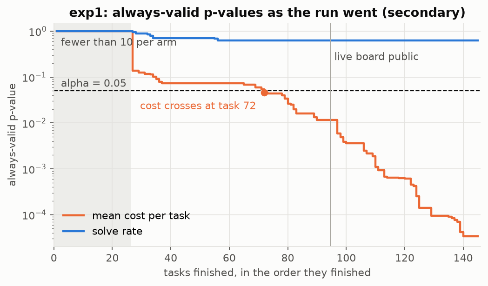
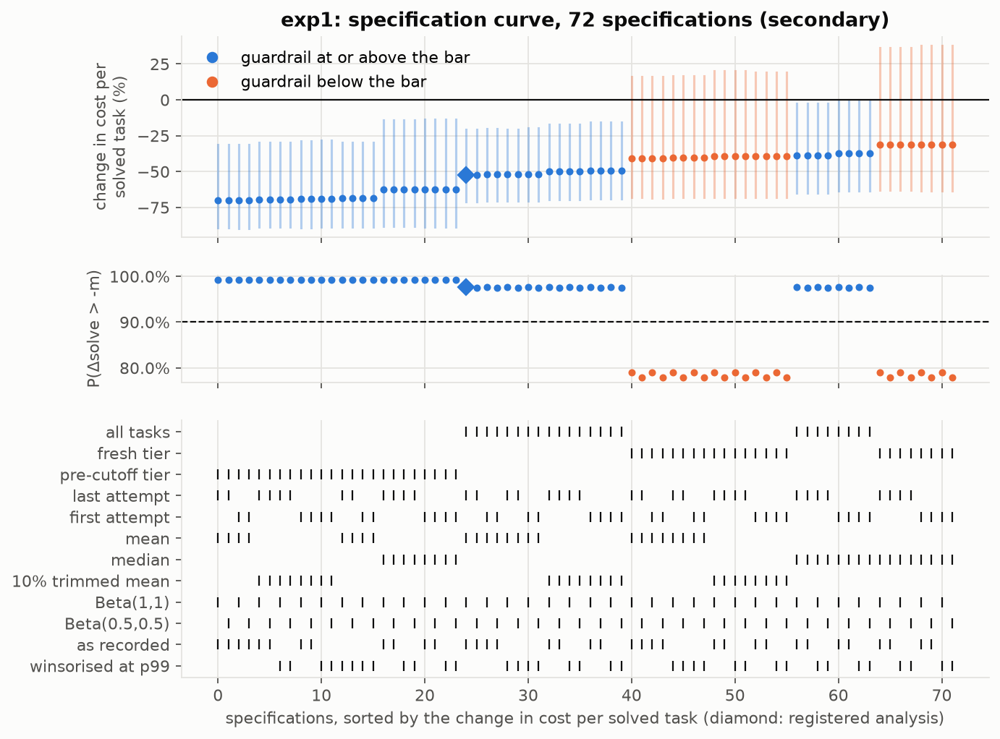
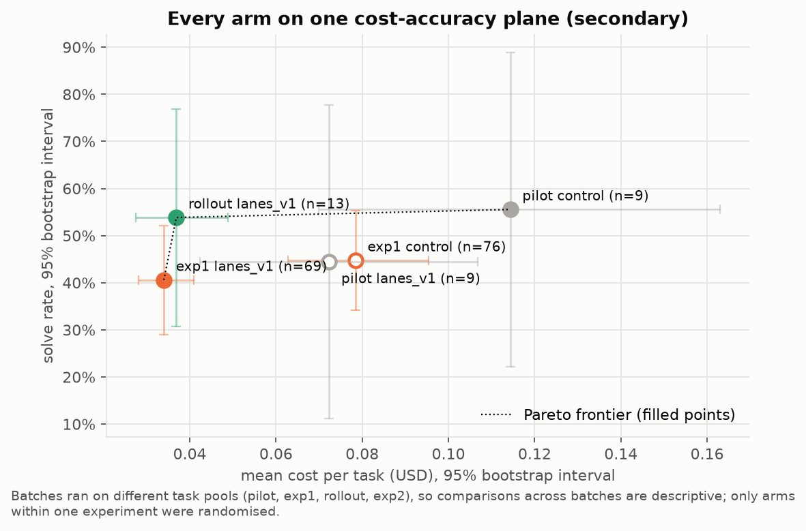

# Results

Every figure in the block below comes from `analysis/out/numbers.json` and is filled by
`analysis/render_docs.py`.

<!--results:start-->

Merkle root over <!--n:integrity.task_done_records:int-->146<!--/n--> `task_done` records: <!--n:integrity.merkle_root:hash12-->7ed364648c75<!--/n-->.

Total model spend: <!--n:spend.total_usd:usd2-->$11.87<!--/n-->.

## Experiment `exp1`

Pre-registration tag <!--n:exp1.prereg.tag:str-->prereg-exp1<!--/n-->, sha256 <!--n:exp1.prereg.sha256:hash12-->44d715bd6bd7<!--/n-->, guardrail margin m = <!--n:exp1.prereg.m:prob1-->20.0%<!--/n--> of solve rate.

| | `control` | `lanes_v1` |
|---|---|---|
| Exposed | <!--n:exp1.arms.control.n_exposed:int-->76<!--/n--> | <!--n:exp1.arms.lanes_v1.n_exposed:int-->69<!--/n--> |
| Excluded | <!--n:exp1.arms.control.n_excluded:int-->0<!--/n--> | <!--n:exp1.arms.lanes_v1.n_excluded:int-->0<!--/n--> |
| Analysed | <!--n:exp1.arms.control.n_analysed:int-->76<!--/n--> | <!--n:exp1.arms.lanes_v1.n_analysed:int-->69<!--/n--> |
| Mean cost per task | <!--n:exp1.arms.control.cost_mean:usd4-->$0.0784<!--/n--> | <!--n:exp1.arms.lanes_v1.cost_mean:usd4-->$0.0340<!--/n--> |
| Median cost per task | <!--n:exp1.arms.control.cost_median:usd4-->$0.0491<!--/n--> | <!--n:exp1.arms.lanes_v1.cost_median:usd4-->$0.0273<!--/n--> |
| Solves | <!--n:exp1.arms.control.solves:int-->34<!--/n--> | <!--n:exp1.arms.lanes_v1.solves:int-->28<!--/n--> |
| Solve rate | <!--n:exp1.arms.control.solve_rate:prob1-->44.7%<!--/n--> | <!--n:exp1.arms.lanes_v1.solve_rate:prob1-->40.6%<!--/n--> |
| Cost per solved task | <!--n:exp1.arms.control.cost_per_solve:usd4-->$0.1753<!--/n--> | <!--n:exp1.arms.lanes_v1.cost_per_solve:usd4-->$0.0837<!--/n--> |
| Delegate share of cost | <!--n:exp1.arms.control.delegate_share_cost:prob1-->62.5%<!--/n--> | <!--n:exp1.arms.lanes_v1.delegate_share_cost:prob1-->11.5%<!--/n--> |
| Delegate share of tokens | <!--n:exp1.arms.control.delegate_share_tokens:prob1-->55.3%<!--/n--> | <!--n:exp1.arms.lanes_v1.delegate_share_tokens:prob1-->64.8%<!--/n--> |
| Mean turns | <!--n:exp1.arms.control.turns_mean:f3-->4.921<!--/n--> | <!--n:exp1.arms.lanes_v1.turns_mean:f3-->5.145<!--/n--> |
| Mean seconds | <!--n:exp1.arms.control.seconds_mean:f3-->622.615<!--/n--> | <!--n:exp1.arms.lanes_v1.seconds_mean:f3-->442.046<!--/n--> |
| Mean cost, bootstrap interval | <!--n:exp1.arms.control.cost_mean_ci.0:usd4-->$0.0632<!--/n--> to <!--n:exp1.arms.control.cost_mean_ci.1:usd4-->$0.0962<!--/n--> | <!--n:exp1.arms.lanes_v1.cost_mean_ci.0:usd4-->$0.0282<!--/n--> to <!--n:exp1.arms.lanes_v1.cost_mean_ci.1:usd4-->$0.0406<!--/n--> |
| Solve rate, posterior interval | <!--n:exp1.arms.control.solve_rate_ci.0:prob1-->34.1%<!--/n--> to <!--n:exp1.arms.control.solve_rate_ci.1:prob1-->55.9%<!--/n--> | <!--n:exp1.arms.lanes_v1.solve_rate_ci.0:prob1-->29.8%<!--/n--> to <!--n:exp1.arms.lanes_v1.solve_rate_ci.1:prob1-->52.4%<!--/n--> |
| Cost per solve, bootstrap interval | <!--n:exp1.arms.control.cost_per_solve_ci.0:usd4-->$0.1233<!--/n--> to <!--n:exp1.arms.control.cost_per_solve_ci.1:usd4-->$0.2607<!--/n--> | <!--n:exp1.arms.lanes_v1.cost_per_solve_ci.0:usd4-->$0.0614<!--/n--> to <!--n:exp1.arms.lanes_v1.cost_per_solve_ci.1:usd4-->$0.1191<!--/n--> |

### Differences (treatment minus control)

- Mean cost: <!--n:exp1.delta.cost_mean:usd4-->−$0.0444<!--/n--> per task (<!--n:exp1.delta.cost_mean_pct:pct1-->−56.7%<!--/n-->), bootstrap interval <!--n:exp1.delta.cost_mean_ci.0:usd4-->−$0.0632<!--/n--> to <!--n:exp1.delta.cost_mean_ci.1:usd4-->−$0.0281<!--/n-->.
- Cost per solved task: <!--n:exp1.delta.cost_per_solve_pct:pct1-->−52.2%<!--/n-->.
- Solve rate: <!--n:exp1.delta.solve_rate_pp:pp1-->−4.2 pp<!--/n-->, posterior interval <!--n:exp1.delta.solve_rate_ci.0:pp1-->−19.8 pp<!--/n--> to <!--n:exp1.delta.solve_rate_ci.1:pp1-->+11.8 pp<!--/n-->.
- Posterior probability that the solve-rate drop is within m: <!--n:exp1.delta.p_solve_drop_within_m:prob1-->97.7%<!--/n-->.

### Sample ratio

Chi-square <!--n:exp1.srm.chi2:f3-->0.338<!--/n-->, p = <!--n:exp1.srm.p:f3-->0.561<!--/n-->, flagged: <!--n:exp1.srm.flag:str-->False<!--/n-->.

### Flagsmith readout

- Chance to beat control on `task_cost`: <!--n:exp1.flagsmith.chance_to_beat_control_cost:prob1-->100.0%<!--/n-->.
- Guardrail `task_solved` status: <!--n:exp1.flagsmith.solve_rate_status:str-->inconclusive<!--/n-->.
- Results pulled at <!--n:exp1.flagsmith.pulled_at:str-->20261127T120242Z<!--/n-->.
- `control` mean cost, absolute difference between our figure and Flagsmith's: <!--n:exp1.agreement.cost_mean_abs_diff.control:usd4-->$0.0000<!--/n-->.
- `lanes_v1` mean cost, absolute difference between our figure and Flagsmith's: <!--n:exp1.agreement.cost_mean_abs_diff.lanes_v1:usd4-->$0.0001<!--/n-->.

### Decision

Ship: <!--n:exp1.decision.ship:str-->lanes_v1<!--/n-->. Flagsmith chance to beat control at or above the pre-registered bar: <!--n:exp1.decision.rule_met.flagsmith_95:str-->True<!--/n-->; guardrail posterior at or above the bar: <!--n:exp1.decision.rule_met.guardrail_90:str-->True<!--/n-->; no Flagsmith guardrail loss: <!--n:exp1.decision.rule_met.no_guardrail_loss:str-->True<!--/n-->.

### Secondary: CUPED (labelled secondary, not part of the decision)

Variance reduction from the pilot-trained cost covariate: <!--n:exp1.cuped.variance_reduction_pct:pct1-->+3.4%<!--/n-->; adjusted mean cost difference <!--n:exp1.cuped.delta_cost_mean:usd4-->−$0.0448<!--/n-->.

### Secondary: by tier (reported, not part of the decision)

`fresh` tasks were created after the models' training cutoff; `pre_cutoff` tasks were created before it.

| tier | `control` n | `control` solve rate | `control` mean cost | `control` cost per solve | `lanes_v1` n | `lanes_v1` solve rate | `lanes_v1` mean cost | `lanes_v1` cost per solve |
|---|---|---|---|---|---|---|---|---|
| `fresh` | <!--n:exp1.by_tier.fresh.control.n:int-->54<!--/n--> | <!--n:exp1.by_tier.fresh.control.solve_rate:prob1-->50.0%<!--/n--> | <!--n:exp1.by_tier.fresh.control.cost_mean:usd4-->$0.0782<!--/n--> | <!--n:exp1.by_tier.fresh.control.cost_per_solve:usd4-->$0.1564<!--/n--> | <!--n:exp1.by_tier.fresh.lanes_v1.n:int-->40<!--/n--> | <!--n:exp1.by_tier.fresh.lanes_v1.solve_rate:prob1-->37.5%<!--/n--> | <!--n:exp1.by_tier.fresh.lanes_v1.cost_mean:usd4-->$0.0346<!--/n--> | <!--n:exp1.by_tier.fresh.lanes_v1.cost_per_solve:usd4-->$0.0924<!--/n--> |
| `pre_cutoff` | <!--n:exp1.by_tier.pre_cutoff.control.n:int-->22<!--/n--> | <!--n:exp1.by_tier.pre_cutoff.control.solve_rate:prob1-->31.8%<!--/n--> | <!--n:exp1.by_tier.pre_cutoff.control.cost_mean:usd4-->$0.0789<!--/n--> | <!--n:exp1.by_tier.pre_cutoff.control.cost_per_solve:usd4-->$0.2480<!--/n--> | <!--n:exp1.by_tier.pre_cutoff.lanes_v1.n:int-->29<!--/n--> | <!--n:exp1.by_tier.pre_cutoff.lanes_v1.solve_rate:prob1-->44.8%<!--/n--> | <!--n:exp1.by_tier.pre_cutoff.lanes_v1.cost_mean:usd4-->$0.0331<!--/n--> | <!--n:exp1.by_tier.pre_cutoff.lanes_v1.cost_per_solve:usd4-->$0.0738<!--/n--> |

- `fresh`: mean cost <!--n:exp1.by_tier.fresh.delta.cost_mean_pct:pct1-->−55.7%<!--/n--> (bootstrap interval <!--n:exp1.by_tier.fresh.delta.cost_mean_pct_ci.0:pct1-->−69.4%<!--/n--> to <!--n:exp1.by_tier.fresh.delta.cost_mean_pct_ci.1:pct1-->−34.3%<!--/n-->), cost per solved task <!--n:exp1.by_tier.fresh.delta.cost_per_solve_pct:pct1-->−40.9%<!--/n-->, solve rate <!--n:exp1.by_tier.fresh.delta.solve_rate_pp:pp1-->−12.5 pp<!--/n--> (posterior interval <!--n:exp1.by_tier.fresh.delta.solve_rate_ci.0:pp1-->−31.1 pp<!--/n--> to <!--n:exp1.by_tier.fresh.delta.solve_rate_ci.1:pp1-->+7.9 pp<!--/n-->), posterior probability that the drop is within m: <!--n:exp1.by_tier.fresh.delta.p_solve_drop_within_m:prob1-->78.9%<!--/n-->.
- `pre_cutoff`: mean cost <!--n:exp1.by_tier.pre_cutoff.delta.cost_mean_pct:pct1-->−58.1%<!--/n--> (bootstrap interval <!--n:exp1.by_tier.pre_cutoff.delta.cost_mean_pct_ci.0:pct1-->−71.8%<!--/n--> to <!--n:exp1.by_tier.pre_cutoff.delta.cost_mean_pct_ci.1:pct1-->−36.3%<!--/n-->), cost per solved task <!--n:exp1.by_tier.pre_cutoff.delta.cost_per_solve_pct:pct1-->−70.3%<!--/n-->, solve rate <!--n:exp1.by_tier.pre_cutoff.delta.solve_rate_pp:pp1-->+13.0 pp<!--/n--> (posterior interval <!--n:exp1.by_tier.pre_cutoff.delta.solve_rate_ci.0:pp1-->−14.0 pp<!--/n--> to <!--n:exp1.by_tier.pre_cutoff.delta.solve_rate_ci.1:pp1-->+36.5 pp<!--/n-->), posterior probability that the drop is within m: <!--n:exp1.by_tier.pre_cutoff.delta.p_solve_drop_within_m:prob1-->99.2%<!--/n-->.

### Secondary: always-valid p-values (added after `exp1` ended, not part of the decision)

The run is replayed in the order its <!--n:exp1.secondary.always_valid.n_tasks:int-->145<!--/n--> analysed tasks finished. A mixture sequential probability ratio test with a normal mixing distribution is evaluated after every task once each arm has <!--n:exp1.secondary.always_valid.min_per_arm:int-->10<!--/n--> tasks, which first happens at task <!--n:exp1.secondary.always_valid.first_evaluated_at:int-->27<!--/n-->. The mixing scale comes from the pilot alone: <!--n:exp1.secondary.always_valid.cost.tau:usd4-->$0.0420<!--/n--> per task for cost and <!--n:exp1.secondary.always_valid.solve.tau:prob1-->11.1%<!--/n--> for solve rate (`analysis/always_valid.py`, DECISIONS.md D29).

- Mean cost per task: always-valid p = <!--n:exp1.secondary.always_valid.cost.p_final:p3--><0.001<!--/n--> at the end; it first fell below <!--n:exp1.secondary.always_valid.alpha:f3-->0.050<!--/n--> after task <!--n:exp1.secondary.always_valid.cost.first_cross_at:int-->72<!--/n-->, which finished at <!--n:exp1.secondary.always_valid.cost.first_cross_finished_at:str-->2026-11-27T03:48:56.964+00:00<!--/n-->. Always-valid interval at the end: <!--n:exp1.secondary.always_valid.cost.ci_final.0:usd4-->−$0.0709<!--/n--> to <!--n:exp1.secondary.always_valid.cost.ci_final.1:usd4-->−$0.0172<!--/n-->.
- Solve rate: always-valid p = <!--n:exp1.secondary.always_valid.solve.p_final:p3-->0.630<!--/n--> at the end, interval <!--n:exp1.secondary.always_valid.solve.ci_final_pp.0:pp1-->−31.2 pp<!--/n--> to <!--n:exp1.secondary.always_valid.solve.ci_final_pp.1:pp1-->+18.4 pp<!--/n-->; it never crossed <!--n:exp1.secondary.always_valid.alpha:f3-->0.050<!--/n--> with `lanes_v1` solving less.
- When the live board went public (DECISIONS.md D24), <!--n:exp1.secondary.always_valid.board_live_after_tasks:int-->94<!--/n--> tasks had finished. The always-valid p was then <!--n:exp1.secondary.always_valid.cost.p_at_board_live:p3-->0.012<!--/n--> for cost and <!--n:exp1.secondary.always_valid.solve.p_at_board_live:p3-->0.630<!--/n--> for solve rate.

### Secondary: specification curve (added after `exp1` ended, not part of the decision)

<!--n:exp1.secondary.multiverse.n_specs:int-->72<!--/n--> specifications: every combination of task set (all, fresh tier, pre-cutoff tier), the attempt kept for an identity that ran twice (last, first), the cost statistic (mean, median, <!--lit-->10%<!--/lit--> trimmed mean), the solve-rate prior (<!--lit-->Beta(1,1)<!--/lit-->, <!--lit-->Beta(0.5,0.5)<!--/lit-->) and cost outliers (as recorded, winsorised at the pooled <!--lit-->99th<!--/lit--> percentile). A tier with too few tasks in an arm is left out (`analysis/multiverse.py`, DECISIONS.md D29).

- Guardrail posterior at or above the bar: <!--n:exp1.secondary.multiverse.guardrail_pass:int-->48<!--/n--> (<!--n:exp1.secondary.multiverse.guardrail_pass_share:prob1-->66.7%<!--/n-->) of specifications.
- Cost per solved task lower under `lanes_v1`: <!--n:exp1.secondary.multiverse.cost_direction:int-->72<!--/n--> (<!--n:exp1.secondary.multiverse.cost_direction_share:prob1-->100.0%<!--/n-->); with the whole bootstrap interval below zero: <!--n:exp1.secondary.multiverse.cps_ci_below_zero:int-->44<!--/n--> (<!--n:exp1.secondary.multiverse.cps_ci_below_zero_share:prob1-->61.1%<!--/n-->).
- Both the guardrail and the cost direction hold: <!--n:exp1.secondary.multiverse.both:int-->48<!--/n--> (<!--n:exp1.secondary.multiverse.both_share:prob1-->66.7%<!--/n-->).
- The change in cost per solved task ranges from <!--n:exp1.secondary.multiverse.cps_change_pct_range.0:pct1-->−70.3%<!--/n--> to <!--n:exp1.secondary.multiverse.cps_change_pct_range.1:pct1-->−31.2%<!--/n-->, and the guardrail posterior from <!--n:exp1.secondary.multiverse.guardrail_posterior_range.0:prob1-->77.9%<!--/n--> to <!--n:exp1.secondary.multiverse.guardrail_posterior_range.1:prob1-->99.2%<!--/n-->.
- Specifications below the guardrail bar use the task set: <!--n:exp1.secondary.multiverse.guardrail_fail_task_sets:str-->fresh tier<!--/n--> (<!--n:exp1.secondary.multiverse.fresh_specs_failing:int-->24<!--/n--> of <!--n:exp1.secondary.multiverse.fresh_specs:int-->24<!--/n--> fresh-tier specifications fail, and <!--n:exp1.secondary.multiverse.non_fresh_specs_failing:int-->0<!--/n--> others do), as in the by-tier section.

Every specification

| task set | attempt | cost statistic | prior | outliers | n control | n treatment | change in cost per solved task | bootstrap interval | P(Δsolve > −m) |
|---|---|---|---|---|---|---|---|---|---|
| all tasks (registered) | last | mean | <!--lit-->Beta(1,1)<!--/lit--> | as recorded | <!--n:exp1.secondary.multiverse.specs.0.n_control:int-->76<!--/n--> | <!--n:exp1.secondary.multiverse.specs.0.n_treatment:int-->69<!--/n--> | <!--n:exp1.secondary.multiverse.specs.0.cps_change_pct:pct1-->−52.2%<!--/n--> | <!--n:exp1.secondary.multiverse.specs.0.cps_change_pct_ci.0:pct1-->−71.0%<!--/n--> to <!--n:exp1.secondary.multiverse.specs.0.cps_change_pct_ci.1:pct1-->−20.8%<!--/n--> | <!--n:exp1.secondary.multiverse.specs.0.guardrail_posterior:prob1-->97.7%<!--/n--> |
| all tasks | last | mean | <!--lit-->Beta(0.5,0.5)<!--/lit--> | as recorded | <!--n:exp1.secondary.multiverse.specs.1.n_control:int-->76<!--/n--> | <!--n:exp1.secondary.multiverse.specs.1.n_treatment:int-->69<!--/n--> | <!--n:exp1.secondary.multiverse.specs.1.cps_change_pct:pct1-->−52.2%<!--/n--> | <!--n:exp1.secondary.multiverse.specs.1.cps_change_pct_ci.0:pct1-->−71.0%<!--/n--> to <!--n:exp1.secondary.multiverse.specs.1.cps_change_pct_ci.1:pct1-->−20.8%<!--/n--> | <!--n:exp1.secondary.multiverse.specs.1.guardrail_posterior:prob1-->97.6%<!--/n--> |
| all tasks | last | median | <!--lit-->Beta(1,1)<!--/lit--> | as recorded | <!--n:exp1.secondary.multiverse.specs.2.n_control:int-->76<!--/n--> | <!--n:exp1.secondary.multiverse.specs.2.n_treatment:int-->69<!--/n--> | <!--n:exp1.secondary.multiverse.specs.2.cps_change_pct:pct1-->−38.8%<!--/n--> | <!--n:exp1.secondary.multiverse.specs.2.cps_change_pct_ci.0:pct1-->−64.8%<!--/n--> to <!--n:exp1.secondary.multiverse.specs.2.cps_change_pct_ci.1:pct1-->−2.6%<!--/n--> | <!--n:exp1.secondary.multiverse.specs.2.guardrail_posterior:prob1-->97.7%<!--/n--> |
| all tasks | last | median | <!--lit-->Beta(0.5,0.5)<!--/lit--> | as recorded | <!--n:exp1.secondary.multiverse.specs.3.n_control:int-->76<!--/n--> | <!--n:exp1.secondary.multiverse.specs.3.n_treatment:int-->69<!--/n--> | <!--n:exp1.secondary.multiverse.specs.3.cps_change_pct:pct1-->−38.8%<!--/n--> | <!--n:exp1.secondary.multiverse.specs.3.cps_change_pct_ci.0:pct1-->−64.8%<!--/n--> to <!--n:exp1.secondary.multiverse.specs.3.cps_change_pct_ci.1:pct1-->−2.6%<!--/n--> | <!--n:exp1.secondary.multiverse.specs.3.guardrail_posterior:prob1-->97.6%<!--/n--> |
| all tasks | last | <!--lit-->10% trimmed mean<!--/lit--> | <!--lit-->Beta(1,1)<!--/lit--> | as recorded | <!--n:exp1.secondary.multiverse.specs.4.n_control:int-->76<!--/n--> | <!--n:exp1.secondary.multiverse.specs.4.n_treatment:int-->69<!--/n--> | <!--n:exp1.secondary.multiverse.specs.4.cps_change_pct:pct1-->−49.6%<!--/n--> | <!--n:exp1.secondary.multiverse.specs.4.cps_change_pct_ci.0:pct1-->−69.7%<!--/n--> to <!--n:exp1.secondary.multiverse.specs.4.cps_change_pct_ci.1:pct1-->−17.1%<!--/n--> | <!--n:exp1.secondary.multiverse.specs.4.guardrail_posterior:prob1-->97.7%<!--/n--> |
| all tasks | last | <!--lit-->10% trimmed mean<!--/lit--> | <!--lit-->Beta(0.5,0.5)<!--/lit--> | as recorded | <!--n:exp1.secondary.multiverse.specs.5.n_control:int-->76<!--/n--> | <!--n:exp1.secondary.multiverse.specs.5.n_treatment:int-->69<!--/n--> | <!--n:exp1.secondary.multiverse.specs.5.cps_change_pct:pct1-->−49.6%<!--/n--> | <!--n:exp1.secondary.multiverse.specs.5.cps_change_pct_ci.0:pct1-->−69.7%<!--/n--> to <!--n:exp1.secondary.multiverse.specs.5.cps_change_pct_ci.1:pct1-->−17.1%<!--/n--> | <!--n:exp1.secondary.multiverse.specs.5.guardrail_posterior:prob1-->97.6%<!--/n--> |
| all tasks | last | mean | <!--lit-->Beta(1,1)<!--/lit--> | <!--lit-->winsorised at p99<!--/lit--> | <!--n:exp1.secondary.multiverse.specs.6.n_control:int-->76<!--/n--> | <!--n:exp1.secondary.multiverse.specs.6.n_treatment:int-->69<!--/n--> | <!--n:exp1.secondary.multiverse.specs.6.cps_change_pct:pct1-->−51.8%<!--/n--> | <!--n:exp1.secondary.multiverse.specs.6.cps_change_pct_ci.0:pct1-->−70.7%<!--/n--> to <!--n:exp1.secondary.multiverse.specs.6.cps_change_pct_ci.1:pct1-->−20.7%<!--/n--> | <!--n:exp1.secondary.multiverse.specs.6.guardrail_posterior:prob1-->97.7%<!--/n--> |
| all tasks | last | mean | <!--lit-->Beta(0.5,0.5)<!--/lit--> | <!--lit-->winsorised at p99<!--/lit--> | <!--n:exp1.secondary.multiverse.specs.7.n_control:int-->76<!--/n--> | <!--n:exp1.secondary.multiverse.specs.7.n_treatment:int-->69<!--/n--> | <!--n:exp1.secondary.multiverse.specs.7.cps_change_pct:pct1-->−51.8%<!--/n--> | <!--n:exp1.secondary.multiverse.specs.7.cps_change_pct_ci.0:pct1-->−70.7%<!--/n--> to <!--n:exp1.secondary.multiverse.specs.7.cps_change_pct_ci.1:pct1-->−20.7%<!--/n--> | <!--n:exp1.secondary.multiverse.specs.7.guardrail_posterior:prob1-->97.6%<!--/n--> |
| all tasks | last | median | <!--lit-->Beta(1,1)<!--/lit--> | <!--lit-->winsorised at p99<!--/lit--> | <!--n:exp1.secondary.multiverse.specs.8.n_control:int-->76<!--/n--> | <!--n:exp1.secondary.multiverse.specs.8.n_treatment:int-->69<!--/n--> | <!--n:exp1.secondary.multiverse.specs.8.cps_change_pct:pct1-->−38.8%<!--/n--> | <!--n:exp1.secondary.multiverse.specs.8.cps_change_pct_ci.0:pct1-->−64.8%<!--/n--> to <!--n:exp1.secondary.multiverse.specs.8.cps_change_pct_ci.1:pct1-->−2.6%<!--/n--> | <!--n:exp1.secondary.multiverse.specs.8.guardrail_posterior:prob1-->97.7%<!--/n--> |
| all tasks | last | median | <!--lit-->Beta(0.5,0.5)<!--/lit--> | <!--lit-->winsorised at p99<!--/lit--> | <!--n:exp1.secondary.multiverse.specs.9.n_control:int-->76<!--/n--> | <!--n:exp1.secondary.multiverse.specs.9.n_treatment:int-->69<!--/n--> | <!--n:exp1.secondary.multiverse.specs.9.cps_change_pct:pct1-->−38.8%<!--/n--> | <!--n:exp1.secondary.multiverse.specs.9.cps_change_pct_ci.0:pct1-->−64.8%<!--/n--> to <!--n:exp1.secondary.multiverse.specs.9.cps_change_pct_ci.1:pct1-->−2.6%<!--/n--> | <!--n:exp1.secondary.multiverse.specs.9.guardrail_posterior:prob1-->97.6%<!--/n--> |
| all tasks | last | <!--lit-->10% trimmed mean<!--/lit--> | <!--lit-->Beta(1,1)<!--/lit--> | <!--lit-->winsorised at p99<!--/lit--> | <!--n:exp1.secondary.multiverse.specs.10.n_control:int-->76<!--/n--> | <!--n:exp1.secondary.multiverse.specs.10.n_treatment:int-->69<!--/n--> | <!--n:exp1.secondary.multiverse.specs.10.cps_change_pct:pct1-->−49.6%<!--/n--> | <!--n:exp1.secondary.multiverse.specs.10.cps_change_pct_ci.0:pct1-->−69.7%<!--/n--> to <!--n:exp1.secondary.multiverse.specs.10.cps_change_pct_ci.1:pct1-->−17.1%<!--/n--> | <!--n:exp1.secondary.multiverse.specs.10.guardrail_posterior:prob1-->97.7%<!--/n--> |
| all tasks | last | <!--lit-->10% trimmed mean<!--/lit--> | <!--lit-->Beta(0.5,0.5)<!--/lit--> | <!--lit-->winsorised at p99<!--/lit--> | <!--n:exp1.secondary.multiverse.specs.11.n_control:int-->76<!--/n--> | <!--n:exp1.secondary.multiverse.specs.11.n_treatment:int-->69<!--/n--> | <!--n:exp1.secondary.multiverse.specs.11.cps_change_pct:pct1-->−49.6%<!--/n--> | <!--n:exp1.secondary.multiverse.specs.11.cps_change_pct_ci.0:pct1-->−69.7%<!--/n--> to <!--n:exp1.secondary.multiverse.specs.11.cps_change_pct_ci.1:pct1-->−17.1%<!--/n--> | <!--n:exp1.secondary.multiverse.specs.11.guardrail_posterior:prob1-->97.6%<!--/n--> |
| all tasks | first | mean | <!--lit-->Beta(1,1)<!--/lit--> | as recorded | <!--n:exp1.secondary.multiverse.specs.12.n_control:int-->76<!--/n--> | <!--n:exp1.secondary.multiverse.specs.12.n_treatment:int-->69<!--/n--> | <!--n:exp1.secondary.multiverse.specs.12.cps_change_pct:pct1-->−52.0%<!--/n--> | <!--n:exp1.secondary.multiverse.specs.12.cps_change_pct_ci.0:pct1-->−70.5%<!--/n--> to <!--n:exp1.secondary.multiverse.specs.12.cps_change_pct_ci.1:pct1-->−20.1%<!--/n--> | <!--n:exp1.secondary.multiverse.specs.12.guardrail_posterior:prob1-->97.7%<!--/n--> |
| all tasks | first | mean | <!--lit-->Beta(0.5,0.5)<!--/lit--> | as recorded | <!--n:exp1.secondary.multiverse.specs.13.n_control:int-->76<!--/n--> | <!--n:exp1.secondary.multiverse.specs.13.n_treatment:int-->69<!--/n--> | <!--n:exp1.secondary.multiverse.specs.13.cps_change_pct:pct1-->−52.0%<!--/n--> | <!--n:exp1.secondary.multiverse.specs.13.cps_change_pct_ci.0:pct1-->−70.5%<!--/n--> to <!--n:exp1.secondary.multiverse.specs.13.cps_change_pct_ci.1:pct1-->−20.1%<!--/n--> | <!--n:exp1.secondary.multiverse.specs.13.guardrail_posterior:prob1-->97.6%<!--/n--> |
| all tasks | first | median | <!--lit-->Beta(1,1)<!--/lit--> | as recorded | <!--n:exp1.secondary.multiverse.specs.14.n_control:int-->76<!--/n--> | <!--n:exp1.secondary.multiverse.specs.14.n_treatment:int-->69<!--/n--> | <!--n:exp1.secondary.multiverse.specs.14.cps_change_pct:pct1-->−37.5%<!--/n--> | <!--n:exp1.secondary.multiverse.specs.14.cps_change_pct_ci.0:pct1-->−63.4%<!--/n--> to <!--n:exp1.secondary.multiverse.specs.14.cps_change_pct_ci.1:pct1-->+0.3%<!--/n--> | <!--n:exp1.secondary.multiverse.specs.14.guardrail_posterior:prob1-->97.7%<!--/n--> |
| all tasks | first | median | <!--lit-->Beta(0.5,0.5)<!--/lit--> | as recorded | <!--n:exp1.secondary.multiverse.specs.15.n_control:int-->76<!--/n--> | <!--n:exp1.secondary.multiverse.specs.15.n_treatment:int-->69<!--/n--> | <!--n:exp1.secondary.multiverse.specs.15.cps_change_pct:pct1-->−37.5%<!--/n--> | <!--n:exp1.secondary.multiverse.specs.15.cps_change_pct_ci.0:pct1-->−63.4%<!--/n--> to <!--n:exp1.secondary.multiverse.specs.15.cps_change_pct_ci.1:pct1-->+0.3%<!--/n--> | <!--n:exp1.secondary.multiverse.specs.15.guardrail_posterior:prob1-->97.6%<!--/n--> |
| all tasks | first | <!--lit-->10% trimmed mean<!--/lit--> | <!--lit-->Beta(1,1)<!--/lit--> | as recorded | <!--n:exp1.secondary.multiverse.specs.16.n_control:int-->76<!--/n--> | <!--n:exp1.secondary.multiverse.specs.16.n_treatment:int-->69<!--/n--> | <!--n:exp1.secondary.multiverse.specs.16.cps_change_pct:pct1-->−49.3%<!--/n--> | <!--n:exp1.secondary.multiverse.specs.16.cps_change_pct_ci.0:pct1-->−69.2%<!--/n--> to <!--n:exp1.secondary.multiverse.specs.16.cps_change_pct_ci.1:pct1-->−15.7%<!--/n--> | <!--n:exp1.secondary.multiverse.specs.16.guardrail_posterior:prob1-->97.7%<!--/n--> |
| all tasks | first | <!--lit-->10% trimmed mean<!--/lit--> | <!--lit-->Beta(0.5,0.5)<!--/lit--> | as recorded | <!--n:exp1.secondary.multiverse.specs.17.n_control:int-->76<!--/n--> | <!--n:exp1.secondary.multiverse.specs.17.n_treatment:int-->69<!--/n--> | <!--n:exp1.secondary.multiverse.specs.17.cps_change_pct:pct1-->−49.3%<!--/n--> | <!--n:exp1.secondary.multiverse.specs.17.cps_change_pct_ci.0:pct1-->−69.2%<!--/n--> to <!--n:exp1.secondary.multiverse.specs.17.cps_change_pct_ci.1:pct1-->−15.7%<!--/n--> | <!--n:exp1.secondary.multiverse.specs.17.guardrail_posterior:prob1-->97.6%<!--/n--> |
| all tasks | first | mean | <!--lit-->Beta(1,1)<!--/lit--> | <!--lit-->winsorised at p99<!--/lit--> | <!--n:exp1.secondary.multiverse.specs.18.n_control:int-->76<!--/n--> | <!--n:exp1.secondary.multiverse.specs.18.n_treatment:int-->69<!--/n--> | <!--n:exp1.secondary.multiverse.specs.18.cps_change_pct:pct1-->−51.6%<!--/n--> | <!--n:exp1.secondary.multiverse.specs.18.cps_change_pct_ci.0:pct1-->−70.3%<!--/n--> to <!--n:exp1.secondary.multiverse.specs.18.cps_change_pct_ci.1:pct1-->−19.7%<!--/n--> | <!--n:exp1.secondary.multiverse.specs.18.guardrail_posterior:prob1-->97.7%<!--/n--> |
| all tasks | first | mean | <!--lit-->Beta(0.5,0.5)<!--/lit--> | <!--lit-->winsorised at p99<!--/lit--> | <!--n:exp1.secondary.multiverse.specs.19.n_control:int-->76<!--/n--> | <!--n:exp1.secondary.multiverse.specs.19.n_treatment:int-->69<!--/n--> | <!--n:exp1.secondary.multiverse.specs.19.cps_change_pct:pct1-->−51.6%<!--/n--> | <!--n:exp1.secondary.multiverse.specs.19.cps_change_pct_ci.0:pct1-->−70.3%<!--/n--> to <!--n:exp1.secondary.multiverse.specs.19.cps_change_pct_ci.1:pct1-->−19.7%<!--/n--> | <!--n:exp1.secondary.multiverse.specs.19.guardrail_posterior:prob1-->97.6%<!--/n--> |
| all tasks | first | median | <!--lit-->Beta(1,1)<!--/lit--> | <!--lit-->winsorised at p99<!--/lit--> | <!--n:exp1.secondary.multiverse.specs.20.n_control:int-->76<!--/n--> | <!--n:exp1.secondary.multiverse.specs.20.n_treatment:int-->69<!--/n--> | <!--n:exp1.secondary.multiverse.specs.20.cps_change_pct:pct1-->−37.5%<!--/n--> | <!--n:exp1.secondary.multiverse.specs.20.cps_change_pct_ci.0:pct1-->−63.4%<!--/n--> to <!--n:exp1.secondary.multiverse.specs.20.cps_change_pct_ci.1:pct1-->+0.3%<!--/n--> | <!--n:exp1.secondary.multiverse.specs.20.guardrail_posterior:prob1-->97.7%<!--/n--> |
| all tasks | first | median | <!--lit-->Beta(0.5,0.5)<!--/lit--> | <!--lit-->winsorised at p99<!--/lit--> | <!--n:exp1.secondary.multiverse.specs.21.n_control:int-->76<!--/n--> | <!--n:exp1.secondary.multiverse.specs.21.n_treatment:int-->69<!--/n--> | <!--n:exp1.secondary.multiverse.specs.21.cps_change_pct:pct1-->−37.5%<!--/n--> | <!--n:exp1.secondary.multiverse.specs.21.cps_change_pct_ci.0:pct1-->−63.4%<!--/n--> to <!--n:exp1.secondary.multiverse.specs.21.cps_change_pct_ci.1:pct1-->+0.3%<!--/n--> | <!--n:exp1.secondary.multiverse.specs.21.guardrail_posterior:prob1-->97.6%<!--/n--> |
| all tasks | first | <!--lit-->10% trimmed mean<!--/lit--> | <!--lit-->Beta(1,1)<!--/lit--> | <!--lit-->winsorised at p99<!--/lit--> | <!--n:exp1.secondary.multiverse.specs.22.n_control:int-->76<!--/n--> | <!--n:exp1.secondary.multiverse.specs.22.n_treatment:int-->69<!--/n--> | <!--n:exp1.secondary.multiverse.specs.22.cps_change_pct:pct1-->−49.3%<!--/n--> | <!--n:exp1.secondary.multiverse.specs.22.cps_change_pct_ci.0:pct1-->−69.2%<!--/n--> to <!--n:exp1.secondary.multiverse.specs.22.cps_change_pct_ci.1:pct1-->−15.7%<!--/n--> | <!--n:exp1.secondary.multiverse.specs.22.guardrail_posterior:prob1-->97.7%<!--/n--> |
| all tasks | first | <!--lit-->10% trimmed mean<!--/lit--> | <!--lit-->Beta(0.5,0.5)<!--/lit--> | <!--lit-->winsorised at p99<!--/lit--> | <!--n:exp1.secondary.multiverse.specs.23.n_control:int-->76<!--/n--> | <!--n:exp1.secondary.multiverse.specs.23.n_treatment:int-->69<!--/n--> | <!--n:exp1.secondary.multiverse.specs.23.cps_change_pct:pct1-->−49.3%<!--/n--> | <!--n:exp1.secondary.multiverse.specs.23.cps_change_pct_ci.0:pct1-->−69.2%<!--/n--> to <!--n:exp1.secondary.multiverse.specs.23.cps_change_pct_ci.1:pct1-->−15.7%<!--/n--> | <!--n:exp1.secondary.multiverse.specs.23.guardrail_posterior:prob1-->97.6%<!--/n--> |
| fresh tier | last | mean | <!--lit-->Beta(1,1)<!--/lit--> | as recorded | <!--n:exp1.secondary.multiverse.specs.24.n_control:int-->54<!--/n--> | <!--n:exp1.secondary.multiverse.specs.24.n_treatment:int-->40<!--/n--> | <!--n:exp1.secondary.multiverse.specs.24.cps_change_pct:pct1-->−40.9%<!--/n--> | <!--n:exp1.secondary.multiverse.specs.24.cps_change_pct_ci.0:pct1-->−68.2%<!--/n--> to <!--n:exp1.secondary.multiverse.specs.24.cps_change_pct_ci.1:pct1-->+16.1%<!--/n--> | <!--n:exp1.secondary.multiverse.specs.24.guardrail_posterior:prob1-->79.0%<!--/n--> |
| fresh tier | last | mean | <!--lit-->Beta(0.5,0.5)<!--/lit--> | as recorded | <!--n:exp1.secondary.multiverse.specs.25.n_control:int-->54<!--/n--> | <!--n:exp1.secondary.multiverse.specs.25.n_treatment:int-->40<!--/n--> | <!--n:exp1.secondary.multiverse.specs.25.cps_change_pct:pct1-->−40.9%<!--/n--> | <!--n:exp1.secondary.multiverse.specs.25.cps_change_pct_ci.0:pct1-->−68.2%<!--/n--> to <!--n:exp1.secondary.multiverse.specs.25.cps_change_pct_ci.1:pct1-->+16.1%<!--/n--> | <!--n:exp1.secondary.multiverse.specs.25.guardrail_posterior:prob1-->77.9%<!--/n--> |
| fresh tier | last | median | <!--lit-->Beta(1,1)<!--/lit--> | as recorded | <!--n:exp1.secondary.multiverse.specs.26.n_control:int-->54<!--/n--> | <!--n:exp1.secondary.multiverse.specs.26.n_treatment:int-->40<!--/n--> | <!--n:exp1.secondary.multiverse.specs.26.cps_change_pct:pct1-->−31.2%<!--/n--> | <!--n:exp1.secondary.multiverse.specs.26.cps_change_pct_ci.0:pct1-->−62.9%<!--/n--> to <!--n:exp1.secondary.multiverse.specs.26.cps_change_pct_ci.1:pct1-->+36.2%<!--/n--> | <!--n:exp1.secondary.multiverse.specs.26.guardrail_posterior:prob1-->79.0%<!--/n--> |
| fresh tier | last | median | <!--lit-->Beta(0.5,0.5)<!--/lit--> | as recorded | <!--n:exp1.secondary.multiverse.specs.27.n_control:int-->54<!--/n--> | <!--n:exp1.secondary.multiverse.specs.27.n_treatment:int-->40<!--/n--> | <!--n:exp1.secondary.multiverse.specs.27.cps_change_pct:pct1-->−31.2%<!--/n--> | <!--n:exp1.secondary.multiverse.specs.27.cps_change_pct_ci.0:pct1-->−62.9%<!--/n--> to <!--n:exp1.secondary.multiverse.specs.27.cps_change_pct_ci.1:pct1-->+36.2%<!--/n--> | <!--n:exp1.secondary.multiverse.specs.27.guardrail_posterior:prob1-->77.9%<!--/n--> |
| fresh tier | last | <!--lit-->10% trimmed mean<!--/lit--> | <!--lit-->Beta(1,1)<!--/lit--> | as recorded | <!--n:exp1.secondary.multiverse.specs.28.n_control:int-->54<!--/n--> | <!--n:exp1.secondary.multiverse.specs.28.n_treatment:int-->40<!--/n--> | <!--n:exp1.secondary.multiverse.specs.28.cps_change_pct:pct1-->−39.5%<!--/n--> | <!--n:exp1.secondary.multiverse.specs.28.cps_change_pct_ci.0:pct1-->−68.0%<!--/n--> to <!--n:exp1.secondary.multiverse.specs.28.cps_change_pct_ci.1:pct1-->+20.0%<!--/n--> | <!--n:exp1.secondary.multiverse.specs.28.guardrail_posterior:prob1-->79.0%<!--/n--> |
| fresh tier | last | <!--lit-->10% trimmed mean<!--/lit--> | <!--lit-->Beta(0.5,0.5)<!--/lit--> | as recorded | <!--n:exp1.secondary.multiverse.specs.29.n_control:int-->54<!--/n--> | <!--n:exp1.secondary.multiverse.specs.29.n_treatment:int-->40<!--/n--> | <!--n:exp1.secondary.multiverse.specs.29.cps_change_pct:pct1-->−39.5%<!--/n--> | <!--n:exp1.secondary.multiverse.specs.29.cps_change_pct_ci.0:pct1-->−68.0%<!--/n--> to <!--n:exp1.secondary.multiverse.specs.29.cps_change_pct_ci.1:pct1-->+20.0%<!--/n--> | <!--n:exp1.secondary.multiverse.specs.29.guardrail_posterior:prob1-->77.9%<!--/n--> |
| fresh tier | last | mean | <!--lit-->Beta(1,1)<!--/lit--> | <!--lit-->winsorised at p99<!--/lit--> | <!--n:exp1.secondary.multiverse.specs.30.n_control:int-->54<!--/n--> | <!--n:exp1.secondary.multiverse.specs.30.n_treatment:int-->40<!--/n--> | <!--n:exp1.secondary.multiverse.specs.30.cps_change_pct:pct1-->−40.3%<!--/n--> | <!--n:exp1.secondary.multiverse.specs.30.cps_change_pct_ci.0:pct1-->−67.8%<!--/n--> to <!--n:exp1.secondary.multiverse.specs.30.cps_change_pct_ci.1:pct1-->+16.7%<!--/n--> | <!--n:exp1.secondary.multiverse.specs.30.guardrail_posterior:prob1-->79.0%<!--/n--> |
| fresh tier | last | mean | <!--lit-->Beta(0.5,0.5)<!--/lit--> | <!--lit-->winsorised at p99<!--/lit--> | <!--n:exp1.secondary.multiverse.specs.31.n_control:int-->54<!--/n--> | <!--n:exp1.secondary.multiverse.specs.31.n_treatment:int-->40<!--/n--> | <!--n:exp1.secondary.multiverse.specs.31.cps_change_pct:pct1-->−40.3%<!--/n--> | <!--n:exp1.secondary.multiverse.specs.31.cps_change_pct_ci.0:pct1-->−67.8%<!--/n--> to <!--n:exp1.secondary.multiverse.specs.31.cps_change_pct_ci.1:pct1-->+16.7%<!--/n--> | <!--n:exp1.secondary.multiverse.specs.31.guardrail_posterior:prob1-->77.9%<!--/n--> |
| fresh tier | last | median | <!--lit-->Beta(1,1)<!--/lit--> | <!--lit-->winsorised at p99<!--/lit--> | <!--n:exp1.secondary.multiverse.specs.32.n_control:int-->54<!--/n--> | <!--n:exp1.secondary.multiverse.specs.32.n_treatment:int-->40<!--/n--> | <!--n:exp1.secondary.multiverse.specs.32.cps_change_pct:pct1-->−31.2%<!--/n--> | <!--n:exp1.secondary.multiverse.specs.32.cps_change_pct_ci.0:pct1-->−62.9%<!--/n--> to <!--n:exp1.secondary.multiverse.specs.32.cps_change_pct_ci.1:pct1-->+36.2%<!--/n--> | <!--n:exp1.secondary.multiverse.specs.32.guardrail_posterior:prob1-->79.0%<!--/n--> |
| fresh tier | last | median | <!--lit-->Beta(0.5,0.5)<!--/lit--> | <!--lit-->winsorised at p99<!--/lit--> | <!--n:exp1.secondary.multiverse.specs.33.n_control:int-->54<!--/n--> | <!--n:exp1.secondary.multiverse.specs.33.n_treatment:int-->40<!--/n--> | <!--n:exp1.secondary.multiverse.specs.33.cps_change_pct:pct1-->−31.2%<!--/n--> | <!--n:exp1.secondary.multiverse.specs.33.cps_change_pct_ci.0:pct1-->−62.9%<!--/n--> to <!--n:exp1.secondary.multiverse.specs.33.cps_change_pct_ci.1:pct1-->+36.2%<!--/n--> | <!--n:exp1.secondary.multiverse.specs.33.guardrail_posterior:prob1-->77.9%<!--/n--> |
| fresh tier | last | <!--lit-->10% trimmed mean<!--/lit--> | <!--lit-->Beta(1,1)<!--/lit--> | <!--lit-->winsorised at p99<!--/lit--> | <!--n:exp1.secondary.multiverse.specs.34.n_control:int-->54<!--/n--> | <!--n:exp1.secondary.multiverse.specs.34.n_treatment:int-->40<!--/n--> | <!--n:exp1.secondary.multiverse.specs.34.cps_change_pct:pct1-->−39.5%<!--/n--> | <!--n:exp1.secondary.multiverse.specs.34.cps_change_pct_ci.0:pct1-->−68.0%<!--/n--> to <!--n:exp1.secondary.multiverse.specs.34.cps_change_pct_ci.1:pct1-->+20.0%<!--/n--> | <!--n:exp1.secondary.multiverse.specs.34.guardrail_posterior:prob1-->79.0%<!--/n--> |
| fresh tier | last | <!--lit-->10% trimmed mean<!--/lit--> | <!--lit-->Beta(0.5,0.5)<!--/lit--> | <!--lit-->winsorised at p99<!--/lit--> | <!--n:exp1.secondary.multiverse.specs.35.n_control:int-->54<!--/n--> | <!--n:exp1.secondary.multiverse.specs.35.n_treatment:int-->40<!--/n--> | <!--n:exp1.secondary.multiverse.specs.35.cps_change_pct:pct1-->−39.5%<!--/n--> | <!--n:exp1.secondary.multiverse.specs.35.cps_change_pct_ci.0:pct1-->−68.0%<!--/n--> to <!--n:exp1.secondary.multiverse.specs.35.cps_change_pct_ci.1:pct1-->+20.0%<!--/n--> | <!--n:exp1.secondary.multiverse.specs.35.guardrail_posterior:prob1-->77.9%<!--/n--> |
| fresh tier | first | mean | <!--lit-->Beta(1,1)<!--/lit--> | as recorded | <!--n:exp1.secondary.multiverse.specs.36.n_control:int-->54<!--/n--> | <!--n:exp1.secondary.multiverse.specs.36.n_treatment:int-->40<!--/n--> | <!--n:exp1.secondary.multiverse.specs.36.cps_change_pct:pct1-->−40.9%<!--/n--> | <!--n:exp1.secondary.multiverse.specs.36.cps_change_pct_ci.0:pct1-->−68.7%<!--/n--> to <!--n:exp1.secondary.multiverse.specs.36.cps_change_pct_ci.1:pct1-->+15.9%<!--/n--> | <!--n:exp1.secondary.multiverse.specs.36.guardrail_posterior:prob1-->79.0%<!--/n--> |
| fresh tier | first | mean | <!--lit-->Beta(0.5,0.5)<!--/lit--> | as recorded | <!--n:exp1.secondary.multiverse.specs.37.n_control:int-->54<!--/n--> | <!--n:exp1.secondary.multiverse.specs.37.n_treatment:int-->40<!--/n--> | <!--n:exp1.secondary.multiverse.specs.37.cps_change_pct:pct1-->−40.9%<!--/n--> | <!--n:exp1.secondary.multiverse.specs.37.cps_change_pct_ci.0:pct1-->−68.7%<!--/n--> to <!--n:exp1.secondary.multiverse.specs.37.cps_change_pct_ci.1:pct1-->+15.9%<!--/n--> | <!--n:exp1.secondary.multiverse.specs.37.guardrail_posterior:prob1-->77.9%<!--/n--> |
| fresh tier | first | median | <!--lit-->Beta(1,1)<!--/lit--> | as recorded | <!--n:exp1.secondary.multiverse.specs.38.n_control:int-->54<!--/n--> | <!--n:exp1.secondary.multiverse.specs.38.n_treatment:int-->40<!--/n--> | <!--n:exp1.secondary.multiverse.specs.38.cps_change_pct:pct1-->−31.2%<!--/n--> | <!--n:exp1.secondary.multiverse.specs.38.cps_change_pct_ci.0:pct1-->−63.4%<!--/n--> to <!--n:exp1.secondary.multiverse.specs.38.cps_change_pct_ci.1:pct1-->+38.0%<!--/n--> | <!--n:exp1.secondary.multiverse.specs.38.guardrail_posterior:prob1-->79.0%<!--/n--> |
| fresh tier | first | median | <!--lit-->Beta(0.5,0.5)<!--/lit--> | as recorded | <!--n:exp1.secondary.multiverse.specs.39.n_control:int-->54<!--/n--> | <!--n:exp1.secondary.multiverse.specs.39.n_treatment:int-->40<!--/n--> | <!--n:exp1.secondary.multiverse.specs.39.cps_change_pct:pct1-->−31.2%<!--/n--> | <!--n:exp1.secondary.multiverse.specs.39.cps_change_pct_ci.0:pct1-->−63.4%<!--/n--> to <!--n:exp1.secondary.multiverse.specs.39.cps_change_pct_ci.1:pct1-->+38.0%<!--/n--> | <!--n:exp1.secondary.multiverse.specs.39.guardrail_posterior:prob1-->77.9%<!--/n--> |
| fresh tier | first | <!--lit-->10% trimmed mean<!--/lit--> | <!--lit-->Beta(1,1)<!--/lit--> | as recorded | <!--n:exp1.secondary.multiverse.specs.40.n_control:int-->54<!--/n--> | <!--n:exp1.secondary.multiverse.specs.40.n_treatment:int-->40<!--/n--> | <!--n:exp1.secondary.multiverse.specs.40.cps_change_pct:pct1-->−39.5%<!--/n--> | <!--n:exp1.secondary.multiverse.specs.40.cps_change_pct_ci.0:pct1-->−68.1%<!--/n--> to <!--n:exp1.secondary.multiverse.specs.40.cps_change_pct_ci.1:pct1-->+19.4%<!--/n--> | <!--n:exp1.secondary.multiverse.specs.40.guardrail_posterior:prob1-->79.0%<!--/n--> |
| fresh tier | first | <!--lit-->10% trimmed mean<!--/lit--> | <!--lit-->Beta(0.5,0.5)<!--/lit--> | as recorded | <!--n:exp1.secondary.multiverse.specs.41.n_control:int-->54<!--/n--> | <!--n:exp1.secondary.multiverse.specs.41.n_treatment:int-->40<!--/n--> | <!--n:exp1.secondary.multiverse.specs.41.cps_change_pct:pct1-->−39.5%<!--/n--> | <!--n:exp1.secondary.multiverse.specs.41.cps_change_pct_ci.0:pct1-->−68.1%<!--/n--> to <!--n:exp1.secondary.multiverse.specs.41.cps_change_pct_ci.1:pct1-->+19.4%<!--/n--> | <!--n:exp1.secondary.multiverse.specs.41.guardrail_posterior:prob1-->77.9%<!--/n--> |
| fresh tier | first | mean | <!--lit-->Beta(1,1)<!--/lit--> | <!--lit-->winsorised at p99<!--/lit--> | <!--n:exp1.secondary.multiverse.specs.42.n_control:int-->54<!--/n--> | <!--n:exp1.secondary.multiverse.specs.42.n_treatment:int-->40<!--/n--> | <!--n:exp1.secondary.multiverse.specs.42.cps_change_pct:pct1-->−40.3%<!--/n--> | <!--n:exp1.secondary.multiverse.specs.42.cps_change_pct_ci.0:pct1-->−68.2%<!--/n--> to <!--n:exp1.secondary.multiverse.specs.42.cps_change_pct_ci.1:pct1-->+16.9%<!--/n--> | <!--n:exp1.secondary.multiverse.specs.42.guardrail_posterior:prob1-->79.0%<!--/n--> |
| fresh tier | first | mean | <!--lit-->Beta(0.5,0.5)<!--/lit--> | <!--lit-->winsorised at p99<!--/lit--> | <!--n:exp1.secondary.multiverse.specs.43.n_control:int-->54<!--/n--> | <!--n:exp1.secondary.multiverse.specs.43.n_treatment:int-->40<!--/n--> | <!--n:exp1.secondary.multiverse.specs.43.cps_change_pct:pct1-->−40.3%<!--/n--> | <!--n:exp1.secondary.multiverse.specs.43.cps_change_pct_ci.0:pct1-->−68.2%<!--/n--> to <!--n:exp1.secondary.multiverse.specs.43.cps_change_pct_ci.1:pct1-->+16.9%<!--/n--> | <!--n:exp1.secondary.multiverse.specs.43.guardrail_posterior:prob1-->77.9%<!--/n--> |
| fresh tier | first | median | <!--lit-->Beta(1,1)<!--/lit--> | <!--lit-->winsorised at p99<!--/lit--> | <!--n:exp1.secondary.multiverse.specs.44.n_control:int-->54<!--/n--> | <!--n:exp1.secondary.multiverse.specs.44.n_treatment:int-->40<!--/n--> | <!--n:exp1.secondary.multiverse.specs.44.cps_change_pct:pct1-->−31.2%<!--/n--> | <!--n:exp1.secondary.multiverse.specs.44.cps_change_pct_ci.0:pct1-->−63.4%<!--/n--> to <!--n:exp1.secondary.multiverse.specs.44.cps_change_pct_ci.1:pct1-->+38.0%<!--/n--> | <!--n:exp1.secondary.multiverse.specs.44.guardrail_posterior:prob1-->79.0%<!--/n--> |
| fresh tier | first | median | <!--lit-->Beta(0.5,0.5)<!--/lit--> | <!--lit-->winsorised at p99<!--/lit--> | <!--n:exp1.secondary.multiverse.specs.45.n_control:int-->54<!--/n--> | <!--n:exp1.secondary.multiverse.specs.45.n_treatment:int-->40<!--/n--> | <!--n:exp1.secondary.multiverse.specs.45.cps_change_pct:pct1-->−31.2%<!--/n--> | <!--n:exp1.secondary.multiverse.specs.45.cps_change_pct_ci.0:pct1-->−63.4%<!--/n--> to <!--n:exp1.secondary.multiverse.specs.45.cps_change_pct_ci.1:pct1-->+38.0%<!--/n--> | <!--n:exp1.secondary.multiverse.specs.45.guardrail_posterior:prob1-->77.9%<!--/n--> |
| fresh tier | first | <!--lit-->10% trimmed mean<!--/lit--> | <!--lit-->Beta(1,1)<!--/lit--> | <!--lit-->winsorised at p99<!--/lit--> | <!--n:exp1.secondary.multiverse.specs.46.n_control:int-->54<!--/n--> | <!--n:exp1.secondary.multiverse.specs.46.n_treatment:int-->40<!--/n--> | <!--n:exp1.secondary.multiverse.specs.46.cps_change_pct:pct1-->−39.5%<!--/n--> | <!--n:exp1.secondary.multiverse.specs.46.cps_change_pct_ci.0:pct1-->−68.1%<!--/n--> to <!--n:exp1.secondary.multiverse.specs.46.cps_change_pct_ci.1:pct1-->+19.4%<!--/n--> | <!--n:exp1.secondary.multiverse.specs.46.guardrail_posterior:prob1-->79.0%<!--/n--> |
| fresh tier | first | <!--lit-->10% trimmed mean<!--/lit--> | <!--lit-->Beta(0.5,0.5)<!--/lit--> | <!--lit-->winsorised at p99<!--/lit--> | <!--n:exp1.secondary.multiverse.specs.47.n_control:int-->54<!--/n--> | <!--n:exp1.secondary.multiverse.specs.47.n_treatment:int-->40<!--/n--> | <!--n:exp1.secondary.multiverse.specs.47.cps_change_pct:pct1-->−39.5%<!--/n--> | <!--n:exp1.secondary.multiverse.specs.47.cps_change_pct_ci.0:pct1-->−68.1%<!--/n--> to <!--n:exp1.secondary.multiverse.specs.47.cps_change_pct_ci.1:pct1-->+19.4%<!--/n--> | <!--n:exp1.secondary.multiverse.specs.47.guardrail_posterior:prob1-->77.9%<!--/n--> |
| pre-cutoff tier | last | mean | <!--lit-->Beta(1,1)<!--/lit--> | as recorded | <!--n:exp1.secondary.multiverse.specs.48.n_control:int-->22<!--/n--> | <!--n:exp1.secondary.multiverse.specs.48.n_treatment:int-->29<!--/n--> | <!--n:exp1.secondary.multiverse.specs.48.cps_change_pct:pct1-->−70.3%<!--/n--> | <!--n:exp1.secondary.multiverse.specs.48.cps_change_pct_ci.0:pct1-->−89.4%<!--/n--> to <!--n:exp1.secondary.multiverse.specs.48.cps_change_pct_ci.1:pct1-->−31.1%<!--/n--> | <!--n:exp1.secondary.multiverse.specs.48.guardrail_posterior:prob1-->99.2%<!--/n--> |
| pre-cutoff tier | last | mean | <!--lit-->Beta(0.5,0.5)<!--/lit--> | as recorded | <!--n:exp1.secondary.multiverse.specs.49.n_control:int-->22<!--/n--> | <!--n:exp1.secondary.multiverse.specs.49.n_treatment:int-->29<!--/n--> | <!--n:exp1.secondary.multiverse.specs.49.cps_change_pct:pct1-->−70.3%<!--/n--> | <!--n:exp1.secondary.multiverse.specs.49.cps_change_pct_ci.0:pct1-->−89.4%<!--/n--> to <!--n:exp1.secondary.multiverse.specs.49.cps_change_pct_ci.1:pct1-->−31.1%<!--/n--> | <!--n:exp1.secondary.multiverse.specs.49.guardrail_posterior:prob1-->99.2%<!--/n--> |
| pre-cutoff tier | last | median | <!--lit-->Beta(1,1)<!--/lit--> | as recorded | <!--n:exp1.secondary.multiverse.specs.50.n_control:int-->22<!--/n--> | <!--n:exp1.secondary.multiverse.specs.50.n_treatment:int-->29<!--/n--> | <!--n:exp1.secondary.multiverse.specs.50.cps_change_pct:pct1-->−62.6%<!--/n--> | <!--n:exp1.secondary.multiverse.specs.50.cps_change_pct_ci.0:pct1-->−88.4%<!--/n--> to <!--n:exp1.secondary.multiverse.specs.50.cps_change_pct_ci.1:pct1-->−14.2%<!--/n--> | <!--n:exp1.secondary.multiverse.specs.50.guardrail_posterior:prob1-->99.2%<!--/n--> |
| pre-cutoff tier | last | median | <!--lit-->Beta(0.5,0.5)<!--/lit--> | as recorded | <!--n:exp1.secondary.multiverse.specs.51.n_control:int-->22<!--/n--> | <!--n:exp1.secondary.multiverse.specs.51.n_treatment:int-->29<!--/n--> | <!--n:exp1.secondary.multiverse.specs.51.cps_change_pct:pct1-->−62.6%<!--/n--> | <!--n:exp1.secondary.multiverse.specs.51.cps_change_pct_ci.0:pct1-->−88.4%<!--/n--> to <!--n:exp1.secondary.multiverse.specs.51.cps_change_pct_ci.1:pct1-->−14.2%<!--/n--> | <!--n:exp1.secondary.multiverse.specs.51.guardrail_posterior:prob1-->99.2%<!--/n--> |
| pre-cutoff tier | last | <!--lit-->10% trimmed mean<!--/lit--> | <!--lit-->Beta(1,1)<!--/lit--> | as recorded | <!--n:exp1.secondary.multiverse.specs.52.n_control:int-->22<!--/n--> | <!--n:exp1.secondary.multiverse.specs.52.n_treatment:int-->29<!--/n--> | <!--n:exp1.secondary.multiverse.specs.52.cps_change_pct:pct1-->−69.4%<!--/n--> | <!--n:exp1.secondary.multiverse.specs.52.cps_change_pct_ci.0:pct1-->−88.8%<!--/n--> to <!--n:exp1.secondary.multiverse.specs.52.cps_change_pct_ci.1:pct1-->−29.5%<!--/n--> | <!--n:exp1.secondary.multiverse.specs.52.guardrail_posterior:prob1-->99.2%<!--/n--> |
| pre-cutoff tier | last | <!--lit-->10% trimmed mean<!--/lit--> | <!--lit-->Beta(0.5,0.5)<!--/lit--> | as recorded | <!--n:exp1.secondary.multiverse.specs.53.n_control:int-->22<!--/n--> | <!--n:exp1.secondary.multiverse.specs.53.n_treatment:int-->29<!--/n--> | <!--n:exp1.secondary.multiverse.specs.53.cps_change_pct:pct1-->−69.4%<!--/n--> | <!--n:exp1.secondary.multiverse.specs.53.cps_change_pct_ci.0:pct1-->−88.8%<!--/n--> to <!--n:exp1.secondary.multiverse.specs.53.cps_change_pct_ci.1:pct1-->−29.5%<!--/n--> | <!--n:exp1.secondary.multiverse.specs.53.guardrail_posterior:prob1-->99.2%<!--/n--> |
| pre-cutoff tier | last | mean | <!--lit-->Beta(1,1)<!--/lit--> | <!--lit-->winsorised at p99<!--/lit--> | <!--n:exp1.secondary.multiverse.specs.54.n_control:int-->22<!--/n--> | <!--n:exp1.secondary.multiverse.specs.54.n_treatment:int-->29<!--/n--> | <!--n:exp1.secondary.multiverse.specs.54.cps_change_pct:pct1-->−68.6%<!--/n--> | <!--n:exp1.secondary.multiverse.specs.54.cps_change_pct_ci.0:pct1-->−88.4%<!--/n--> to <!--n:exp1.secondary.multiverse.specs.54.cps_change_pct_ci.1:pct1-->−29.6%<!--/n--> | <!--n:exp1.secondary.multiverse.specs.54.guardrail_posterior:prob1-->99.2%<!--/n--> |
| pre-cutoff tier | last | mean | <!--lit-->Beta(0.5,0.5)<!--/lit--> | <!--lit-->winsorised at p99<!--/lit--> | <!--n:exp1.secondary.multiverse.specs.55.n_control:int-->22<!--/n--> | <!--n:exp1.secondary.multiverse.specs.55.n_treatment:int-->29<!--/n--> | <!--n:exp1.secondary.multiverse.specs.55.cps_change_pct:pct1-->−68.6%<!--/n--> | <!--n:exp1.secondary.multiverse.specs.55.cps_change_pct_ci.0:pct1-->−88.4%<!--/n--> to <!--n:exp1.secondary.multiverse.specs.55.cps_change_pct_ci.1:pct1-->−29.6%<!--/n--> | <!--n:exp1.secondary.multiverse.specs.55.guardrail_posterior:prob1-->99.2%<!--/n--> |
| pre-cutoff tier | last | median | <!--lit-->Beta(1,1)<!--/lit--> | <!--lit-->winsorised at p99<!--/lit--> | <!--n:exp1.secondary.multiverse.specs.56.n_control:int-->22<!--/n--> | <!--n:exp1.secondary.multiverse.specs.56.n_treatment:int-->29<!--/n--> | <!--n:exp1.secondary.multiverse.specs.56.cps_change_pct:pct1-->−62.6%<!--/n--> | <!--n:exp1.secondary.multiverse.specs.56.cps_change_pct_ci.0:pct1-->−88.4%<!--/n--> to <!--n:exp1.secondary.multiverse.specs.56.cps_change_pct_ci.1:pct1-->−14.2%<!--/n--> | <!--n:exp1.secondary.multiverse.specs.56.guardrail_posterior:prob1-->99.2%<!--/n--> |
| pre-cutoff tier | last | median | <!--lit-->Beta(0.5,0.5)<!--/lit--> | <!--lit-->winsorised at p99<!--/lit--> | <!--n:exp1.secondary.multiverse.specs.57.n_control:int-->22<!--/n--> | <!--n:exp1.secondary.multiverse.specs.57.n_treatment:int-->29<!--/n--> | <!--n:exp1.secondary.multiverse.specs.57.cps_change_pct:pct1-->−62.6%<!--/n--> | <!--n:exp1.secondary.multiverse.specs.57.cps_change_pct_ci.0:pct1-->−88.4%<!--/n--> to <!--n:exp1.secondary.multiverse.specs.57.cps_change_pct_ci.1:pct1-->−14.2%<!--/n--> | <!--n:exp1.secondary.multiverse.specs.57.guardrail_posterior:prob1-->99.2%<!--/n--> |
| pre-cutoff tier | last | <!--lit-->10% trimmed mean<!--/lit--> | <!--lit-->Beta(1,1)<!--/lit--> | <!--lit-->winsorised at p99<!--/lit--> | <!--n:exp1.secondary.multiverse.specs.58.n_control:int-->22<!--/n--> | <!--n:exp1.secondary.multiverse.specs.58.n_treatment:int-->29<!--/n--> | <!--n:exp1.secondary.multiverse.specs.58.cps_change_pct:pct1-->−69.4%<!--/n--> | <!--n:exp1.secondary.multiverse.specs.58.cps_change_pct_ci.0:pct1-->−88.6%<!--/n--> to <!--n:exp1.secondary.multiverse.specs.58.cps_change_pct_ci.1:pct1-->−29.4%<!--/n--> | <!--n:exp1.secondary.multiverse.specs.58.guardrail_posterior:prob1-->99.2%<!--/n--> |
| pre-cutoff tier | last | <!--lit-->10% trimmed mean<!--/lit--> | <!--lit-->Beta(0.5,0.5)<!--/lit--> | <!--lit-->winsorised at p99<!--/lit--> | <!--n:exp1.secondary.multiverse.specs.59.n_control:int-->22<!--/n--> | <!--n:exp1.secondary.multiverse.specs.59.n_treatment:int-->29<!--/n--> | <!--n:exp1.secondary.multiverse.specs.59.cps_change_pct:pct1-->−69.4%<!--/n--> | <!--n:exp1.secondary.multiverse.specs.59.cps_change_pct_ci.0:pct1-->−88.6%<!--/n--> to <!--n:exp1.secondary.multiverse.specs.59.cps_change_pct_ci.1:pct1-->−29.4%<!--/n--> | <!--n:exp1.secondary.multiverse.specs.59.guardrail_posterior:prob1-->99.2%<!--/n--> |
| pre-cutoff tier | first | mean | <!--lit-->Beta(1,1)<!--/lit--> | as recorded | <!--n:exp1.secondary.multiverse.specs.60.n_control:int-->22<!--/n--> | <!--n:exp1.secondary.multiverse.specs.60.n_treatment:int-->29<!--/n--> | <!--n:exp1.secondary.multiverse.specs.60.cps_change_pct:pct1-->−69.9%<!--/n--> | <!--n:exp1.secondary.multiverse.specs.60.cps_change_pct_ci.0:pct1-->−89.4%<!--/n--> to <!--n:exp1.secondary.multiverse.specs.60.cps_change_pct_ci.1:pct1-->−31.3%<!--/n--> | <!--n:exp1.secondary.multiverse.specs.60.guardrail_posterior:prob1-->99.2%<!--/n--> |
| pre-cutoff tier | first | mean | <!--lit-->Beta(0.5,0.5)<!--/lit--> | as recorded | <!--n:exp1.secondary.multiverse.specs.61.n_control:int-->22<!--/n--> | <!--n:exp1.secondary.multiverse.specs.61.n_treatment:int-->29<!--/n--> | <!--n:exp1.secondary.multiverse.specs.61.cps_change_pct:pct1-->−69.9%<!--/n--> | <!--n:exp1.secondary.multiverse.specs.61.cps_change_pct_ci.0:pct1-->−89.4%<!--/n--> to <!--n:exp1.secondary.multiverse.specs.61.cps_change_pct_ci.1:pct1-->−31.3%<!--/n--> | <!--n:exp1.secondary.multiverse.specs.61.guardrail_posterior:prob1-->99.2%<!--/n--> |
| pre-cutoff tier | first | median | <!--lit-->Beta(1,1)<!--/lit--> | as recorded | <!--n:exp1.secondary.multiverse.specs.62.n_control:int-->22<!--/n--> | <!--n:exp1.secondary.multiverse.specs.62.n_treatment:int-->29<!--/n--> | <!--n:exp1.secondary.multiverse.specs.62.cps_change_pct:pct1-->−62.6%<!--/n--> | <!--n:exp1.secondary.multiverse.specs.62.cps_change_pct_ci.0:pct1-->−88.7%<!--/n--> to <!--n:exp1.secondary.multiverse.specs.62.cps_change_pct_ci.1:pct1-->−13.7%<!--/n--> | <!--n:exp1.secondary.multiverse.specs.62.guardrail_posterior:prob1-->99.2%<!--/n--> |
| pre-cutoff tier | first | median | <!--lit-->Beta(0.5,0.5)<!--/lit--> | as recorded | <!--n:exp1.secondary.multiverse.specs.63.n_control:int-->22<!--/n--> | <!--n:exp1.secondary.multiverse.specs.63.n_treatment:int-->29<!--/n--> | <!--n:exp1.secondary.multiverse.specs.63.cps_change_pct:pct1-->−62.6%<!--/n--> | <!--n:exp1.secondary.multiverse.specs.63.cps_change_pct_ci.0:pct1-->−88.7%<!--/n--> to <!--n:exp1.secondary.multiverse.specs.63.cps_change_pct_ci.1:pct1-->−13.7%<!--/n--> | <!--n:exp1.secondary.multiverse.specs.63.guardrail_posterior:prob1-->99.2%<!--/n--> |
| pre-cutoff tier | first | <!--lit-->10% trimmed mean<!--/lit--> | <!--lit-->Beta(1,1)<!--/lit--> | as recorded | <!--n:exp1.secondary.multiverse.specs.64.n_control:int-->22<!--/n--> | <!--n:exp1.secondary.multiverse.specs.64.n_treatment:int-->29<!--/n--> | <!--n:exp1.secondary.multiverse.specs.64.cps_change_pct:pct1-->−68.9%<!--/n--> | <!--n:exp1.secondary.multiverse.specs.64.cps_change_pct_ci.0:pct1-->−89.0%<!--/n--> to <!--n:exp1.secondary.multiverse.specs.64.cps_change_pct_ci.1:pct1-->−28.4%<!--/n--> | <!--n:exp1.secondary.multiverse.specs.64.guardrail_posterior:prob1-->99.2%<!--/n--> |
| pre-cutoff tier | first | <!--lit-->10% trimmed mean<!--/lit--> | <!--lit-->Beta(0.5,0.5)<!--/lit--> | as recorded | <!--n:exp1.secondary.multiverse.specs.65.n_control:int-->22<!--/n--> | <!--n:exp1.secondary.multiverse.specs.65.n_treatment:int-->29<!--/n--> | <!--n:exp1.secondary.multiverse.specs.65.cps_change_pct:pct1-->−68.9%<!--/n--> | <!--n:exp1.secondary.multiverse.specs.65.cps_change_pct_ci.0:pct1-->−89.0%<!--/n--> to <!--n:exp1.secondary.multiverse.specs.65.cps_change_pct_ci.1:pct1-->−28.4%<!--/n--> | <!--n:exp1.secondary.multiverse.specs.65.guardrail_posterior:prob1-->99.2%<!--/n--> |
| pre-cutoff tier | first | mean | <!--lit-->Beta(1,1)<!--/lit--> | <!--lit-->winsorised at p99<!--/lit--> | <!--n:exp1.secondary.multiverse.specs.66.n_control:int-->22<!--/n--> | <!--n:exp1.secondary.multiverse.specs.66.n_treatment:int-->29<!--/n--> | <!--n:exp1.secondary.multiverse.specs.66.cps_change_pct:pct1-->−68.3%<!--/n--> | <!--n:exp1.secondary.multiverse.specs.66.cps_change_pct_ci.0:pct1-->−88.7%<!--/n--> to <!--n:exp1.secondary.multiverse.specs.66.cps_change_pct_ci.1:pct1-->−29.7%<!--/n--> | <!--n:exp1.secondary.multiverse.specs.66.guardrail_posterior:prob1-->99.2%<!--/n--> |
| pre-cutoff tier | first | mean | <!--lit-->Beta(0.5,0.5)<!--/lit--> | <!--lit-->winsorised at p99<!--/lit--> | <!--n:exp1.secondary.multiverse.specs.67.n_control:int-->22<!--/n--> | <!--n:exp1.secondary.multiverse.specs.67.n_treatment:int-->29<!--/n--> | <!--n:exp1.secondary.multiverse.specs.67.cps_change_pct:pct1-->−68.3%<!--/n--> | <!--n:exp1.secondary.multiverse.specs.67.cps_change_pct_ci.0:pct1-->−88.7%<!--/n--> to <!--n:exp1.secondary.multiverse.specs.67.cps_change_pct_ci.1:pct1-->−29.7%<!--/n--> | <!--n:exp1.secondary.multiverse.specs.67.guardrail_posterior:prob1-->99.2%<!--/n--> |
| pre-cutoff tier | first | median | <!--lit-->Beta(1,1)<!--/lit--> | <!--lit-->winsorised at p99<!--/lit--> | <!--n:exp1.secondary.multiverse.specs.68.n_control:int-->22<!--/n--> | <!--n:exp1.secondary.multiverse.specs.68.n_treatment:int-->29<!--/n--> | <!--n:exp1.secondary.multiverse.specs.68.cps_change_pct:pct1-->−62.6%<!--/n--> | <!--n:exp1.secondary.multiverse.specs.68.cps_change_pct_ci.0:pct1-->−88.7%<!--/n--> to <!--n:exp1.secondary.multiverse.specs.68.cps_change_pct_ci.1:pct1-->−13.7%<!--/n--> | <!--n:exp1.secondary.multiverse.specs.68.guardrail_posterior:prob1-->99.2%<!--/n--> |
| pre-cutoff tier | first | median | <!--lit-->Beta(0.5,0.5)<!--/lit--> | <!--lit-->winsorised at p99<!--/lit--> | <!--n:exp1.secondary.multiverse.specs.69.n_control:int-->22<!--/n--> | <!--n:exp1.secondary.multiverse.specs.69.n_treatment:int-->29<!--/n--> | <!--n:exp1.secondary.multiverse.specs.69.cps_change_pct:pct1-->−62.6%<!--/n--> | <!--n:exp1.secondary.multiverse.specs.69.cps_change_pct_ci.0:pct1-->−88.7%<!--/n--> to <!--n:exp1.secondary.multiverse.specs.69.cps_change_pct_ci.1:pct1-->−13.7%<!--/n--> | <!--n:exp1.secondary.multiverse.specs.69.guardrail_posterior:prob1-->99.2%<!--/n--> |
| pre-cutoff tier | first | <!--lit-->10% trimmed mean<!--/lit--> | <!--lit-->Beta(1,1)<!--/lit--> | <!--lit-->winsorised at p99<!--/lit--> | <!--n:exp1.secondary.multiverse.specs.70.n_control:int-->22<!--/n--> | <!--n:exp1.secondary.multiverse.specs.70.n_treatment:int-->29<!--/n--> | <!--n:exp1.secondary.multiverse.specs.70.cps_change_pct:pct1-->−68.9%<!--/n--> | <!--n:exp1.secondary.multiverse.specs.70.cps_change_pct_ci.0:pct1-->−88.7%<!--/n--> to <!--n:exp1.secondary.multiverse.specs.70.cps_change_pct_ci.1:pct1-->−28.4%<!--/n--> | <!--n:exp1.secondary.multiverse.specs.70.guardrail_posterior:prob1-->99.2%<!--/n--> |
| pre-cutoff tier | first | <!--lit-->10% trimmed mean<!--/lit--> | <!--lit-->Beta(0.5,0.5)<!--/lit--> | <!--lit-->winsorised at p99<!--/lit--> | <!--n:exp1.secondary.multiverse.specs.71.n_control:int-->22<!--/n--> | <!--n:exp1.secondary.multiverse.specs.71.n_treatment:int-->29<!--/n--> | <!--n:exp1.secondary.multiverse.specs.71.cps_change_pct:pct1-->−68.9%<!--/n--> | <!--n:exp1.secondary.multiverse.specs.71.cps_change_pct_ci.0:pct1-->−88.7%<!--/n--> to <!--n:exp1.secondary.multiverse.specs.71.cps_change_pct_ci.1:pct1-->−28.4%<!--/n--> | <!--n:exp1.secondary.multiverse.specs.71.guardrail_posterior:prob1-->99.2%<!--/n--> |

### By trait

#### `difficulty`

| level | `control` n | `control` solve rate | `control` mean cost | `lanes_v1` n | `lanes_v1` solve rate | `lanes_v1` mean cost |
|---|---|---|---|---|---|---|
| `low` | <!--n:exp1.by_trait.difficulty.low.control.n:int-->25<!--/n--> | <!--n:exp1.by_trait.difficulty.low.control.solve_rate:prob1-->68.0%<!--/n--> | <!--n:exp1.by_trait.difficulty.low.control.cost_mean:usd4-->$0.0700<!--/n--> | <!--n:exp1.by_trait.difficulty.low.lanes_v1.n:int-->24<!--/n--> | <!--n:exp1.by_trait.difficulty.low.lanes_v1.solve_rate:prob1-->58.3%<!--/n--> | <!--n:exp1.by_trait.difficulty.low.lanes_v1.cost_mean:usd4-->$0.0288<!--/n--> |
| `mid` | <!--n:exp1.by_trait.difficulty.mid.control.n:int-->28<!--/n--> | <!--n:exp1.by_trait.difficulty.mid.control.solve_rate:prob1-->46.4%<!--/n--> | <!--n:exp1.by_trait.difficulty.mid.control.cost_mean:usd4-->$0.0590<!--/n--> | <!--n:exp1.by_trait.difficulty.mid.lanes_v1.n:int-->22<!--/n--> | <!--n:exp1.by_trait.difficulty.mid.lanes_v1.solve_rate:prob1-->40.9%<!--/n--> | <!--n:exp1.by_trait.difficulty.mid.lanes_v1.cost_mean:usd4-->$0.0387<!--/n--> |
| `high` | <!--n:exp1.by_trait.difficulty.high.control.n:int-->23<!--/n--> | <!--n:exp1.by_trait.difficulty.high.control.solve_rate:prob1-->17.4%<!--/n--> | <!--n:exp1.by_trait.difficulty.high.control.cost_mean:usd4-->$0.1112<!--/n--> | <!--n:exp1.by_trait.difficulty.high.lanes_v1.n:int-->23<!--/n--> | <!--n:exp1.by_trait.difficulty.high.lanes_v1.solve_rate:prob1-->21.7%<!--/n--> | <!--n:exp1.by_trait.difficulty.high.lanes_v1.cost_mean:usd4-->$0.0349<!--/n--> |

#### `language`

| level | `control` n | `control` solve rate | `control` mean cost | `lanes_v1` n | `lanes_v1` solve rate | `lanes_v1` mean cost |
|---|---|---|---|---|---|---|
| `c` | <!--n:exp1.by_trait.language.c.control.n:int-->11<!--/n--> | <!--n:exp1.by_trait.language.c.control.solve_rate:prob1-->63.6%<!--/n--> | <!--n:exp1.by_trait.language.c.control.cost_mean:usd4-->$0.0982<!--/n--> | <!--n:exp1.by_trait.language.c.lanes_v1.n:int-->13<!--/n--> | <!--n:exp1.by_trait.language.c.lanes_v1.solve_rate:prob1-->38.5%<!--/n--> | <!--n:exp1.by_trait.language.c.lanes_v1.cost_mean:usd4-->$0.0462<!--/n--> |
| `cpp` | <!--n:exp1.by_trait.language.cpp.control.n:int-->7<!--/n--> | <!--n:exp1.by_trait.language.cpp.control.solve_rate:prob1-->42.9%<!--/n--> | <!--n:exp1.by_trait.language.cpp.control.cost_mean:usd4-->$0.0834<!--/n--> | <!--n:exp1.by_trait.language.cpp.lanes_v1.n:int-->13<!--/n--> | <!--n:exp1.by_trait.language.cpp.lanes_v1.solve_rate:prob1-->38.5%<!--/n--> | <!--n:exp1.by_trait.language.cpp.lanes_v1.cost_mean:usd4-->$0.0287<!--/n--> |
| `cs` | <!--n:exp1.by_trait.language.cs.control.n:int-->10<!--/n--> | <!--n:exp1.by_trait.language.cs.control.solve_rate:prob1-->20.0%<!--/n--> | <!--n:exp1.by_trait.language.cs.control.cost_mean:usd4-->$0.0896<!--/n--> | <!--n:exp1.by_trait.language.cs.lanes_v1.n:int-->4<!--/n--> | <!--n:exp1.by_trait.language.cs.lanes_v1.solve_rate:prob1-->25.0%<!--/n--> | <!--n:exp1.by_trait.language.cs.lanes_v1.cost_mean:usd4-->$0.0240<!--/n--> |
| `go` | <!--n:exp1.by_trait.language.go.control.n:int-->4<!--/n--> | <!--n:exp1.by_trait.language.go.control.solve_rate:prob1-->0.0%<!--/n--> | <!--n:exp1.by_trait.language.go.control.cost_mean:usd4-->$0.1135<!--/n--> | <!--n:exp1.by_trait.language.go.lanes_v1.n:int-->9<!--/n--> | <!--n:exp1.by_trait.language.go.lanes_v1.solve_rate:prob1-->55.6%<!--/n--> | <!--n:exp1.by_trait.language.go.lanes_v1.cost_mean:usd4-->$0.0372<!--/n--> |
| `java` | <!--n:exp1.by_trait.language.java.control.n:int-->23<!--/n--> | <!--n:exp1.by_trait.language.java.control.solve_rate:prob1-->73.9%<!--/n--> | <!--n:exp1.by_trait.language.java.control.cost_mean:usd4-->$0.0417<!--/n--> | <!--n:exp1.by_trait.language.java.lanes_v1.n:int-->18<!--/n--> | <!--n:exp1.by_trait.language.java.lanes_v1.solve_rate:prob1-->50.0%<!--/n--> | <!--n:exp1.by_trait.language.java.lanes_v1.cost_mean:usd4-->$0.0262<!--/n--> |
| `js` | <!--n:exp1.by_trait.language.js.control.n:int-->7<!--/n--> | <!--n:exp1.by_trait.language.js.control.solve_rate:prob1-->14.3%<!--/n--> | <!--n:exp1.by_trait.language.js.control.cost_mean:usd4-->$0.0677<!--/n--> | <!--n:exp1.by_trait.language.js.lanes_v1.n:int-->3<!--/n--> | <!--n:exp1.by_trait.language.js.lanes_v1.solve_rate:prob1-->33.3%<!--/n--> | <!--n:exp1.by_trait.language.js.lanes_v1.cost_mean:usd4-->$0.0280<!--/n--> |
| `rust` | <!--n:exp1.by_trait.language.rust.control.n:int-->13<!--/n--> | <!--n:exp1.by_trait.language.rust.control.solve_rate:prob1-->23.1%<!--/n--> | <!--n:exp1.by_trait.language.rust.control.cost_mean:usd4-->$0.1122<!--/n--> | <!--n:exp1.by_trait.language.rust.lanes_v1.n:int-->8<!--/n--> | <!--n:exp1.by_trait.language.rust.lanes_v1.solve_rate:prob1-->25.0%<!--/n--> | <!--n:exp1.by_trait.language.rust.lanes_v1.cost_mean:usd4-->$0.0444<!--/n--> |
| `ts` | <!--n:exp1.by_trait.language.ts.control.n:int-->1<!--/n--> | <!--n:exp1.by_trait.language.ts.control.solve_rate:prob1-->100.0%<!--/n--> | <!--n:exp1.by_trait.language.ts.control.cost_mean:usd4-->$0.0542<!--/n--> | <!--n:exp1.by_trait.language.ts.lanes_v1.n:int-->1<!--/n--> | <!--n:exp1.by_trait.language.ts.lanes_v1.solve_rate:prob1-->0.0%<!--/n--> | <!--n:exp1.by_trait.language.ts.lanes_v1.cost_mean:usd4-->$0.0303<!--/n--> |

#### `created_month`

| level | `control` n | `control` solve rate | `control` mean cost | `lanes_v1` n | `lanes_v1` solve rate | `lanes_v1` mean cost |
|---|---|---|---|---|---|---|
| `2026-03` | <!--n:exp1.by_trait.created_month.2026-03.control.n:int-->9<!--/n--> | <!--n:exp1.by_trait.created_month.2026-03.control.solve_rate:prob1-->22.2%<!--/n--> | <!--n:exp1.by_trait.created_month.2026-03.control.cost_mean:usd4-->$0.0810<!--/n--> | <!--n:exp1.by_trait.created_month.2026-03.lanes_v1.n:int-->12<!--/n--> | <!--n:exp1.by_trait.created_month.2026-03.lanes_v1.solve_rate:prob1-->50.0%<!--/n--> | <!--n:exp1.by_trait.created_month.2026-03.lanes_v1.cost_mean:usd4-->$0.0273<!--/n--> |
| `2026-04` | <!--n:exp1.by_trait.created_month.2026-04.control.n:int-->10<!--/n--> | <!--n:exp1.by_trait.created_month.2026-04.control.solve_rate:prob1-->40.0%<!--/n--> | <!--n:exp1.by_trait.created_month.2026-04.control.cost_mean:usd4-->$0.0774<!--/n--> | <!--n:exp1.by_trait.created_month.2026-04.lanes_v1.n:int-->14<!--/n--> | <!--n:exp1.by_trait.created_month.2026-04.lanes_v1.solve_rate:prob1-->35.7%<!--/n--> | <!--n:exp1.by_trait.created_month.2026-04.lanes_v1.cost_mean:usd4-->$0.0342<!--/n--> |
| `2026-05` | <!--n:exp1.by_trait.created_month.2026-05.control.n:int-->1<!--/n--> | <!--n:exp1.by_trait.created_month.2026-05.control.solve_rate:prob1-->0.0%<!--/n--> | <!--n:exp1.by_trait.created_month.2026-05.control.cost_mean:usd4-->$0.0775<!--/n--> | <!--n:exp1.by_trait.created_month.2026-05.lanes_v1.n:int-->0<!--/n--> | <!--n:exp1.by_trait.created_month.2026-05.lanes_v1.solve_rate:prob1-->n/a<!--/n--> | <!--n:exp1.by_trait.created_month.2026-05.lanes_v1.cost_mean:usd4-->n/a<!--/n--> |
| `2026-06` | <!--n:exp1.by_trait.created_month.2026-06.control.n:int-->2<!--/n--> | <!--n:exp1.by_trait.created_month.2026-06.control.solve_rate:prob1-->50.0%<!--/n--> | <!--n:exp1.by_trait.created_month.2026-06.control.cost_mean:usd4-->$0.0776<!--/n--> | <!--n:exp1.by_trait.created_month.2026-06.lanes_v1.n:int-->3<!--/n--> | <!--n:exp1.by_trait.created_month.2026-06.lanes_v1.solve_rate:prob1-->66.7%<!--/n--> | <!--n:exp1.by_trait.created_month.2026-06.lanes_v1.cost_mean:usd4-->$0.0512<!--/n--> |
| `2026-07` | <!--n:exp1.by_trait.created_month.2026-07.control.n:int-->54<!--/n--> | <!--n:exp1.by_trait.created_month.2026-07.control.solve_rate:prob1-->50.0%<!--/n--> | <!--n:exp1.by_trait.created_month.2026-07.control.cost_mean:usd4-->$0.0782<!--/n--> | <!--n:exp1.by_trait.created_month.2026-07.lanes_v1.n:int-->40<!--/n--> | <!--n:exp1.by_trait.created_month.2026-07.lanes_v1.solve_rate:prob1-->37.5%<!--/n--> | <!--n:exp1.by_trait.created_month.2026-07.lanes_v1.cost_mean:usd4-->$0.0346<!--/n--> |

## Secondary: every arm on one cost-accuracy plane (added after `exp1` ended)

Mean cost per task against solve rate for every arm the project ran, with percentile bootstrap intervals on both. An arm is on the frontier when no other arm costs no more and solves no less. The batches ran on different task pools (pilot, exp1, rollout, exp2), so a comparison across batches describes them and tests nothing; only the arms within one experiment were randomised (`analysis/frontier.py`).

| arm | tasks | mean cost | interval | solve rate | interval | on the frontier |
|---|---|---|---|---|---|---|
| <!--n:frontier.arms.pilot_control.label:str-->pilot control<!--/n--> | <!--n:frontier.arms.pilot_control.n:int-->9<!--/n--> | <!--n:frontier.arms.pilot_control.cost_mean:usd4-->$0.1143<!--/n--> | <!--n:frontier.arms.pilot_control.cost_mean_ci.0:usd4-->$0.0698<!--/n--> to <!--n:frontier.arms.pilot_control.cost_mean_ci.1:usd4-->$0.1630<!--/n--> | <!--n:frontier.arms.pilot_control.solve_rate:prob1-->55.6%<!--/n--> | <!--n:frontier.arms.pilot_control.solve_rate_ci.0:prob1-->22.2%<!--/n--> to <!--n:frontier.arms.pilot_control.solve_rate_ci.1:prob1-->88.9%<!--/n--> | <!--n:frontier.arms.pilot_control.on_frontier:str-->True<!--/n--> |
| <!--n:frontier.arms.pilot_lanes_v1.label:str-->pilot lanes_v1<!--/n--> | <!--n:frontier.arms.pilot_lanes_v1.n:int-->9<!--/n--> | <!--n:frontier.arms.pilot_lanes_v1.cost_mean:usd4-->$0.0723<!--/n--> | <!--n:frontier.arms.pilot_lanes_v1.cost_mean_ci.0:usd4-->$0.0423<!--/n--> to <!--n:frontier.arms.pilot_lanes_v1.cost_mean_ci.1:usd4-->$0.1067<!--/n--> | <!--n:frontier.arms.pilot_lanes_v1.solve_rate:prob1-->44.4%<!--/n--> | <!--n:frontier.arms.pilot_lanes_v1.solve_rate_ci.0:prob1-->11.1%<!--/n--> to <!--n:frontier.arms.pilot_lanes_v1.solve_rate_ci.1:prob1-->77.8%<!--/n--> | <!--n:frontier.arms.pilot_lanes_v1.on_frontier:str-->False<!--/n--> |
| <!--n:frontier.arms.exp1_control.label:str-->exp1 control<!--/n--> | <!--n:frontier.arms.exp1_control.n:int-->76<!--/n--> | <!--n:frontier.arms.exp1_control.cost_mean:usd4-->$0.0784<!--/n--> | <!--n:frontier.arms.exp1_control.cost_mean_ci.0:usd4-->$0.0628<!--/n--> to <!--n:frontier.arms.exp1_control.cost_mean_ci.1:usd4-->$0.0954<!--/n--> | <!--n:frontier.arms.exp1_control.solve_rate:prob1-->44.7%<!--/n--> | <!--n:frontier.arms.exp1_control.solve_rate_ci.0:prob1-->34.2%<!--/n--> to <!--n:frontier.arms.exp1_control.solve_rate_ci.1:prob1-->55.3%<!--/n--> | <!--n:frontier.arms.exp1_control.on_frontier:str-->False<!--/n--> |
| <!--n:frontier.arms.exp1_lanes_v1.label:str-->exp1 lanes_v1<!--/n--> | <!--n:frontier.arms.exp1_lanes_v1.n:int-->69<!--/n--> | <!--n:frontier.arms.exp1_lanes_v1.cost_mean:usd4-->$0.0340<!--/n--> | <!--n:frontier.arms.exp1_lanes_v1.cost_mean_ci.0:usd4-->$0.0282<!--/n--> to <!--n:frontier.arms.exp1_lanes_v1.cost_mean_ci.1:usd4-->$0.0410<!--/n--> | <!--n:frontier.arms.exp1_lanes_v1.solve_rate:prob1-->40.6%<!--/n--> | <!--n:frontier.arms.exp1_lanes_v1.solve_rate_ci.0:prob1-->29.0%<!--/n--> to <!--n:frontier.arms.exp1_lanes_v1.solve_rate_ci.1:prob1-->52.2%<!--/n--> | <!--n:frontier.arms.exp1_lanes_v1.on_frontier:str-->True<!--/n--> |
| <!--n:frontier.arms.rollout_lanes_v1.label:str-->rollout lanes_v1<!--/n--> | <!--n:frontier.arms.rollout_lanes_v1.n:int-->13<!--/n--> | <!--n:frontier.arms.rollout_lanes_v1.cost_mean:usd4-->$0.0369<!--/n--> | <!--n:frontier.arms.rollout_lanes_v1.cost_mean_ci.0:usd4-->$0.0274<!--/n--> to <!--n:frontier.arms.rollout_lanes_v1.cost_mean_ci.1:usd4-->$0.0488<!--/n--> | <!--n:frontier.arms.rollout_lanes_v1.solve_rate:prob1-->53.8%<!--/n--> | <!--n:frontier.arms.rollout_lanes_v1.solve_rate_ci.0:prob1-->30.8%<!--/n--> to <!--n:frontier.arms.rollout_lanes_v1.solve_rate_ci.1:prob1-->76.9%<!--/n--> | <!--n:frontier.arms.rollout_lanes_v1.on_frontier:str-->True<!--/n--> |

## Integrity: inclusion proofs

Every `task_done` record has an audit path to its run's Merkle root (`integrity/merkle.py`). `uv run python -m integrity.prove --run runs/exp1 --task <identity>` prints one and checks it; the files below hold every path, for the site.

- `exp1`: <!--n:integrity.proofs.exp1.verified:int-->146<!--/n--> of <!--n:integrity.proofs.exp1.leaves:int-->146<!--/n--> leaves verified against root <!--n:integrity.proofs.exp1.root:hash12-->7ed364648c75<!--/n-->, longest path <!--n:integrity.proofs.exp1.path_length_max:int-->8<!--/n--> hashes, <!--n:integrity.proofs.exp1.bytes:int-->98,341<!--/n--> bytes in `analysis/out/proofs/exp1.json`.
- `rollout`: <!--n:integrity.proofs.rollout.verified:int-->13<!--/n--> of <!--n:integrity.proofs.rollout.leaves:int-->13<!--/n--> leaves verified against root <!--n:integrity.proofs.rollout.root:hash12-->735b016d232f<!--/n-->, longest path <!--n:integrity.proofs.rollout.path_length_max:int-->4<!--/n--> hashes, <!--n:integrity.proofs.rollout.bytes:int-->5,724<!--/n--> bytes in `analysis/out/proofs/rollout.json`.
<!--results:end-->
