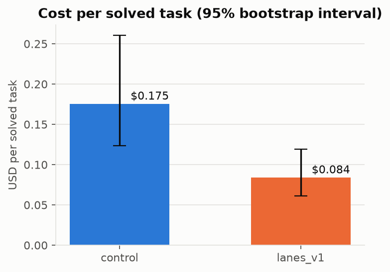
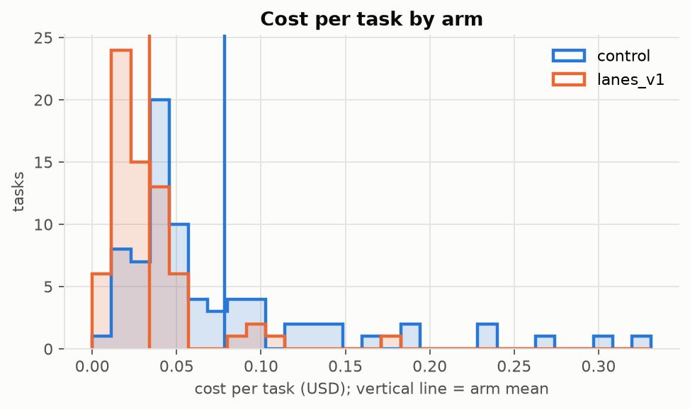
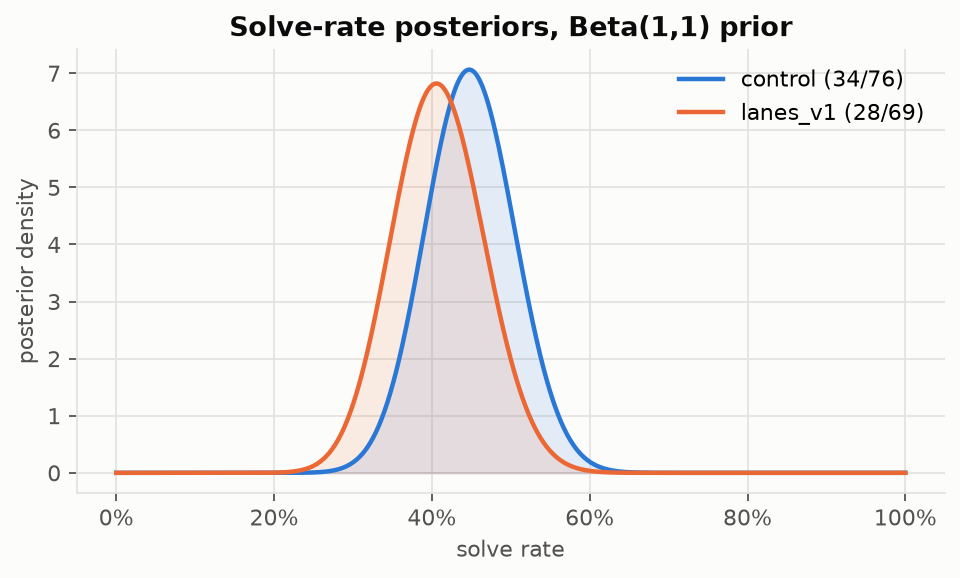
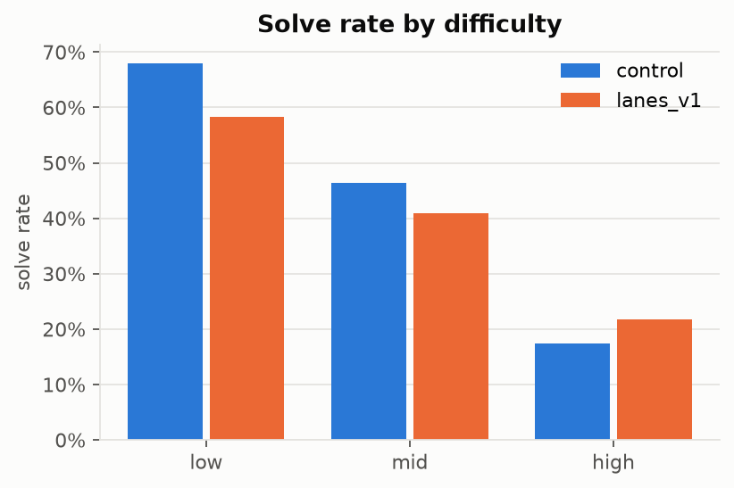
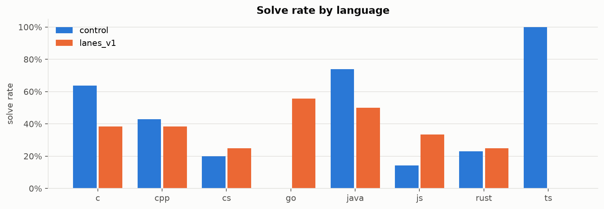
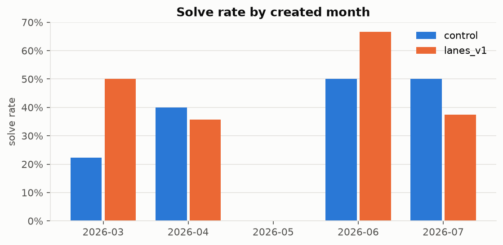

# Fork in the Bill: a pre-registered feature-flag experiment on a coding agent's model routing

Fork in the Bill team (CoffeeAndToggle)

Toggle Wars hackathon, Track 01. Source: https://github.com/Prashant-thakur77/fork-in-the-bill. Live board: https://forkbill.prashantthakur.dev

## Abstract

A coding agent spends many of its tokens on work that needs little judgement: searching a repository, reading long files, running tests and reading the log. We asked whether moving that work from a frontier model to a small one lowers the dollars spent per solved task. The agent has two lanes. A planner on Claude Sonnet 5.5 decides and edits, and a worker lane does the grunt work. In the `control` arm the worker is also Sonnet; in `lanes_v1` it is Claude Haiku 5.5. Flagsmith assigned every task to an arm through an experiment on one multivariate flag, recorded the exposure, received the outcome events and computed the verdict our decision rule reads. The hypothesis, metrics, margin and decision rule were hashed, tagged and pushed before the experiment started. On <!--n:exp1.arms.control.n_analysed:int-->76<!--/n--> control and <!--n:exp1.arms.lanes_v1.n_analysed:int-->69<!--/n--> lanes_v1 SWE-bench-Live tasks, the small worker cut mean cost per task by <!--n:exp1.delta.cost_mean_pct:pct1-->−56.7%<!--/n--> and cost per solved task from <!--n:exp1.arms.control.cost_per_solve:usd4-->$0.1753<!--/n--> to <!--n:exp1.arms.lanes_v1.cost_per_solve:usd4-->$0.0837<!--/n-->. The solve rate moved from <!--n:exp1.arms.control.solve_rate:prob1-->44.7%<!--/n--> to <!--n:exp1.arms.lanes_v1.solve_rate:prob1-->40.6%<!--/n-->, a difference of <!--n:exp1.delta.solve_rate_pp:pp1-->−4.2 pp<!--/n--> with a posterior interval of <!--n:exp1.delta.solve_rate_ci.0:pp1-->−19.8 pp<!--/n--> to <!--n:exp1.delta.solve_rate_ci.1:pp1-->+11.8 pp<!--/n-->. All three pre-registered conditions held, so `lanes_v1` shipped. Every recorded arm was re-derived offline from Flagsmith's own evaluation engine, and every figure in this paper is filled from one JSON file and checked by script. The experiment rules out large solve-rate losses only; a drop of a few points would go undetected at this size.

## 1 Introduction

Agent frameworks often let a main model hand sub-tasks to a helper. If the helper runs on the same frontier model, the cheap work is billed at the frontier price. The gap is large. In the pricing table this project uses (`harness/pricing.json`, checked on 2026-11-27), Sonnet 5.5 costs $2 per million input tokens and $10 per million output tokens, and Haiku 5.5 costs $0.10 and $0.50. In our pilot (`prereg/pilot-report.md`), the worker lane took 61% of the all-Sonnet arm's cost.

Moving the worker to the small model is the obvious saving. What it does to the number of tasks the agent solves is less obvious, and a lower solve rate can eat the saving: if each task is cheaper but fewer are solved, the cost per solved task can stay flat or rise. Published routing results come from other agents and other task sets, so they don't settle this for a given harness. The direct way to find out is a controlled experiment on real tasks where something other than the person running it picks the arm.

This paper reports experiment 1 of that study. Its contributions are practical:

- a two-lane agent harness whose arms differ in one field of a JSON policy served by a feature flag;
- a pre-registered decision rule that reads the flag platform's own verdict and a separate replication;
- an integrity trail (hash-chained ledger, environment snapshots and offline re-derivation of every assignment) that a reader can check with one command;
- the result: the small worker halved the cost per solved task with no large solve-rate loss.

## 2 Related practice

Randomised online experiments are the standard way product teams decide whether a change helps. A unit (a user, a session, here a task) is hashed into an arm, an exposure is logged at the point the arm takes effect, and outcomes are joined back to the exposure. Two habits from that practice matter here. One is the guardrail metric, which a change must not harm even when it wins on the primary metric. The other is the sample-ratio check: if the arms receive a different share of units than the split says, something in the pipeline is broken and the result shouldn't be trusted.

Pre-registration comes from clinical and social science. The analysis plan is fixed and published before data arrive, so that choices like the metric, the margin or when to stop can't be tuned to the result. Repeatedly checking a running experiment and stopping when it looks good inflates false positives; a fixed stopping rule avoids that. A guardrail framed as "no worse than a margin" is a non-inferiority test, and the margin has to be justified by the sample size the study can afford.

Model routing and cascades send each request, or each part of a request, to the cheapest model that can handle it. Orchestrator and worker designs, where a strong model plans and smaller models carry out narrow steps, are one form of this. Claims about these designs are usually made on benchmark suites with the routing chosen by the authors. Our setup is narrower: one harness, one model pair, and a flag platform choosing the arm per task.

## 3 Method

### 3.1 Units and task pools

A unit is one SWE-bench-Live MultiLang task: a real issue in a C, C++, C#, Go, Java, JavaScript, Rust or TypeScript repository, with tests that fail before the fix (FAIL_TO_PASS) and tests that must keep passing (PASS_TO_PASS). Tasks were drawn from one difficulty stratum: gold patches touching at most 3 files and 60 changed lines, problem statements under 12,000 characters (DECISIONS.md, D10). Pools are drawn by a seeded selection (seed 20261127) and are disjoint: pilot, experiment 1, rollout and experiment 2 never share a task. Each task is validated arm-blind before it is enqueued: its gold patch is applied and its tests run, with no model involved.

The registered pool held every task in the stratum created on or after 2026-07-01, after the models' training cutoff. Each task is one Flagsmith identity, `swelive:<instance_id>`, with the traits `repo`, `language`, `created_month`, `gold_files` and `gold_lines`.

### 3.2 Arms

Both arms use the same planner and the same harness. They differ in one field of the flag value, `delegate.model`.

Table: Arms. Each variation's value is the full routing policy as JSON (`flagsmith/policies/`).

| Variation key | Planner (main lane) | Worker (delegate lane) |
|---|---|---|
| `control` (the flag's own value) | `claude-sonnet-5-5` | `claude-sonnet-5-5` |
| `lanes_v1` | `claude-sonnet-5-5` | `claude-haiku-5-5` |

Prompts, tools and tool order, effort per lane, token limits and the per-task caps (40 planner turns, $0.60 and 1200 seconds of agent time) are identical. `RoutingPolicy.clean_ab_diff` checks this, and `flagsmith/setup.sh` refuses to create a variant that differs in anything else.

### 3.3 Assignment through Flagsmith

The runner never picks an arm. `harness/policy.py` calls `get_experiment_flag("agent_routing", identifier=..., traits=...)` once per task, which returns the variant and records the exposure, and flushes the event at once (D9). The Flagsmith experiment (id 822) splits `agent_routing` 50/50 at 100% rollout, which Flagsmith implements as a system segment override on the flag; the flag is locked while the experiment runs. A separate boolean flag, `routing_kill`, forces the control policy with no exposure and no events. The registration allows it for safety only and requires every use to be logged; the experiment 1 ledger has no kill-switch record.

### 3.4 Metrics

After grading, `harness/events.py` sends four events under the same identifier as the exposure, so Flagsmith can join them.

Table: Metrics as defined in Flagsmith (`flagsmith/metrics.json`).

| Metric | Aggregation | Direction | Value | Role |
|---|---|---|---|---|
| `task_cost` | mean | down | US dollars, every exposed task | primary |
| `task_solved` | occurrence | up | 1, only when every FAIL_TO_PASS and PASS_TO_PASS test passes in a fresh grading container | guardrail |
| `task_turns` | mean | informational | planner turns | secondary |
| `task_seconds` | mean | informational | seconds from assignment to end of grading | secondary |

Flagsmith has no ratio metric. Cost per solved task is mean cost divided by solve rate, computed in `analysis/analyse.py`.

### 3.5 Pre-registration and amendment

`prereg/experiment-1.md` holds the question, hypothesis, arms, metrics, decision rule, power analysis, exclusions and stopping rule. Its SHA-256 (`44d715bd6bd7f8580e8bb1950a21ea852dfea4daaf040c84009f391bf56e19c2`) is in `prereg/HASHES.txt`. It was committed at 2026-11-26 22:57:35 UTC, tagged `prereg-exp1`, and passed CI on GitHub (run 45908009314) about five minutes before the Flagsmith experiment started at 23:02:34 UTC. The hypothesis text was pasted unchanged into the experiment's `hypothesis` field.

The registration missed one constraint. Flagsmith shows no inference for a metric until each variant has 50 identities, and the fresh pool was expected to give about 43 per arm, so the first condition of the decision rule could never have passed. Amendment 1 (`prereg/experiment-1-amendment-1.md`, tag `prereg-exp1-amend1`, committed 23:14:42 UTC) added the next 80 tasks created between 2026-03-01 and 2026-06-30, from the same stratum and the same seeded order. When it was written three tasks had finished, and the author had seen only exposure and event counts, with no result per arm and no cost. The arms, flag values, caps, metrics, margin, decision rule and stopping rule did not change. The amendment also asks for the fresh and pre-cutoff tiers to be reported separately as a secondary analysis outside the decision.

### 3.6 Decision rule

Ship `lanes_v1` only if all three hold; otherwise keep `control` and publish the reason.

1. Flagsmith reports a chance to beat control of at least 95% on `task_cost`.
2. Our `Beta(1,1)` posterior gives P(Δsolve > −m) ≥ 0.90, with m = 20 percentage points, where Δsolve is the lanes_v1 solve rate minus the control solve rate.
3. Flagsmith does not report `task_solved` as losing (chance to beat control below 5%).

There is no early stopping. The run ends when every task in both pools is done, excluded or invalid.

### 3.7 Power, and the margin chosen after the pilot

The pilot ran 9 tasks under each policy, forced by the runner outside any experiment. From it, `analysis/power.py` (2000 simulations, seed 20260202) gave the figures in the amendment: at 70 tasks per arm, a 25% cut in mean cost is detected with 80% power, a solve-rate drop of 20 points is detected with 80% power, and an arm truly as good as control passes rule 2 87% of the time. A drop of 5 points would go undetected; ruling it out would need roughly 800 tasks per arm.

We disclose that the margin m = 20 points was chosen after the pilot had been run and looked at, and before any experiment task ran (D19). It was set so that an arm as good as control passes the guardrail more often than not at the size the fresh pool allows. A 5-point margin would have failed almost every time even for an equal arm, so the experiment would have decided nothing. A reader who wanted a tighter margin should read rule 2 as a check against large losses only.

### 3.8 Exclusions

Infrastructure failures (image pull, container start, git trouble in the container, provider errors after retries) are retried once, then excluded and listed. Events are sent only for a task's final attempt. Agent failures (refusals, hitting a cap, malformed loops) are never excluded. A sample-ratio p-value below 0.001 would have stopped any action on the results until the cause was found.

### 3.9 Harness changes before registration

Three changes made during dry runs shaped the arms. All three apply identically to both and were in place before the pilot, so the pilot, the registration and the experiment use the same harness.

- D16: the shared planner prompt tells the agent to delegate surveys, long reads and test runs. In the dry run before it, the planner never delegated in four tasks.
- D17: the planner's shell output was cut to the first and last 1 KB. It still delegated nothing; it switched to tighter `sed -n` and `grep | head` commands.
- D18: the planner lost its shell. It has `view_file`, `edit_file`, `delegate` and `submit`; the worker has `bash` with 16 KB of output in the same container.

Without these the two arms would have run the same model on nearly every call and measured nothing. The result applies to this planner and worker design, not to an agent that does its own grunt work.

### 3.10 Analysis

Our replication uses different methods from Flagsmith's on purpose (D12). Flagsmith approximates the relative lift as normal (delta method) and reports a chance to win and a 95% interval. We use a percentile bootstrap for mean cost and cost per solved task, and independent `Beta(1,1)` posteriors for solve rate. When the two agree, the result is less likely to be an artefact of one method. The sample-ratio check is a chi-square test against the 50/50 split.

## 4 Integrity

Each run writes a hash-chained ledger (`runs/<exp>/ledger.jsonl`). Every record's hash is `sha256(prev_hash + canonical_json(payload))`, so editing or deleting any record breaks every hash after it. The ledger holds task completions, events sent, exclusions, environment snapshots, configuration checks and kill-switch uses. A Merkle root over the `task_done` records (raw 32-byte leaves, an odd node paired with itself) gives one value to publish and compare.

`integrity/snapshot_env.py` saves the Flagsmith environment document at the start, every 15 minutes and at the end of a run (D21), and writes each snapshot's hash to the ledger. A change to the flag or the split during the run would show as a second distinct hash.

Flagsmith assigns a variant by hashing the identity, so the arm each task should have run follows from the environment document. `integrity/verify_assignment.py` evaluates every identity in the run against the saved start-of-run document with Flagsmith's `flag-engine`, the code the SDK's local evaluation uses, and fails if any recorded arm differs.

Every figure in this paper is a marker filled from `analysis/out/numbers.json` by `analysis/render_docs.py`. `analysis/check_consistency.py` fails CI if any marker is stale or if a bare number appears inside a results block.

<!--results:start-->

For `exp1`, the Merkle root over <!--n:integrity.task_done_records:int-->146<!--/n--> `task_done` records is `<!--n:integrity.merkle_root:str-->7ed364648c7513ef22280eaed97a2ab77e92d91b8f88f5bbfab08d747a989929<!--/n-->`. The run took <!--n:integrity.env_snapshots:int-->56<!--/n--> environment snapshots with <!--n:integrity.env_snapshot_distinct_hashes:int-->1<!--/n--> distinct hash. Flagsmith's engine (version <!--n:integrity.assignment.flag_engine_version:str-->11.1.2<!--/n-->), run offline against the start-of-run document (SHA-256 prefix <!--n:integrity.assignment.env_sha256:hash12-->9f01eed3330f<!--/n-->), reproduced <!--n:integrity.assignment.matched:int-->146<!--/n--> of <!--n:integrity.assignment.checked:int-->146<!--/n--> recorded arms, with <!--n:integrity.assignment.mismatched:int-->0<!--/n--> mismatches.

The ledger holds one more `task_done` record than there are analysed tasks. One identity, `swelive:gui-cs__Terminal.Gui-4860`, ran twice: its second attempt started after the first had finished. Both attempts ran `lanes_v1` and both were unsolved. The analysis keeps the last attempt of each identity.

<!--results:end-->

## 5 Results

All figures in this section come from `analysis/out/numbers.json` (Flagsmith results pulled at the time shown below, saved raw under `analysis/flagsmith/exp1/`).

<!--results:start-->

### Main table

Table: Experiment `exp1`, `lanes_v1` against `control`. Intervals are percentile bootstrap intervals for costs and posterior intervals for solve rates.

| | `control` | `lanes_v1` |
|---|---|---|
| Tasks exposed | <!--n:exp1.arms.control.n_exposed:int-->76<!--/n--> | <!--n:exp1.arms.lanes_v1.n_exposed:int-->69<!--/n--> |
| Excluded | <!--n:exp1.arms.control.n_excluded:int-->0<!--/n--> | <!--n:exp1.arms.lanes_v1.n_excluded:int-->0<!--/n--> |
| Analysed | <!--n:exp1.arms.control.n_analysed:int-->76<!--/n--> | <!--n:exp1.arms.lanes_v1.n_analysed:int-->69<!--/n--> |
| Mean cost per task | <!--n:exp1.arms.control.cost_mean:usd4-->$0.0784<!--/n--> | <!--n:exp1.arms.lanes_v1.cost_mean:usd4-->$0.0340<!--/n--> |
| Mean cost, interval | <!--n:exp1.arms.control.cost_mean_ci.0:usd4-->$0.0632<!--/n--> to <!--n:exp1.arms.control.cost_mean_ci.1:usd4-->$0.0962<!--/n--> | <!--n:exp1.arms.lanes_v1.cost_mean_ci.0:usd4-->$0.0282<!--/n--> to <!--n:exp1.arms.lanes_v1.cost_mean_ci.1:usd4-->$0.0406<!--/n--> |
| Median cost per task | <!--n:exp1.arms.control.cost_median:usd4-->$0.0491<!--/n--> | <!--n:exp1.arms.lanes_v1.cost_median:usd4-->$0.0273<!--/n--> |
| Solves | <!--n:exp1.arms.control.solves:int-->34<!--/n--> | <!--n:exp1.arms.lanes_v1.solves:int-->28<!--/n--> |
| Solve rate | <!--n:exp1.arms.control.solve_rate:prob1-->44.7%<!--/n--> | <!--n:exp1.arms.lanes_v1.solve_rate:prob1-->40.6%<!--/n--> |
| Solve rate, interval | <!--n:exp1.arms.control.solve_rate_ci.0:prob1-->34.1%<!--/n--> to <!--n:exp1.arms.control.solve_rate_ci.1:prob1-->55.9%<!--/n--> | <!--n:exp1.arms.lanes_v1.solve_rate_ci.0:prob1-->29.8%<!--/n--> to <!--n:exp1.arms.lanes_v1.solve_rate_ci.1:prob1-->52.4%<!--/n--> |
| Cost per solved task | <!--n:exp1.arms.control.cost_per_solve:usd4-->$0.1753<!--/n--> | <!--n:exp1.arms.lanes_v1.cost_per_solve:usd4-->$0.0837<!--/n--> |
| Cost per solved task, interval | <!--n:exp1.arms.control.cost_per_solve_ci.0:usd4-->$0.1233<!--/n--> to <!--n:exp1.arms.control.cost_per_solve_ci.1:usd4-->$0.2607<!--/n--> | <!--n:exp1.arms.lanes_v1.cost_per_solve_ci.0:usd4-->$0.0614<!--/n--> to <!--n:exp1.arms.lanes_v1.cost_per_solve_ci.1:usd4-->$0.1191<!--/n--> |
| Worker share of cost | <!--n:exp1.arms.control.delegate_share_cost:prob1-->62.5%<!--/n--> | <!--n:exp1.arms.lanes_v1.delegate_share_cost:prob1-->11.5%<!--/n--> |
| Worker share of tokens | <!--n:exp1.arms.control.delegate_share_tokens:prob1-->55.3%<!--/n--> | <!--n:exp1.arms.lanes_v1.delegate_share_tokens:prob1-->64.8%<!--/n--> |
| Mean planner turns | <!--n:exp1.arms.control.turns_mean:f3-->4.921<!--/n--> | <!--n:exp1.arms.lanes_v1.turns_mean:f3-->5.145<!--/n--> |
| Mean seconds, assignment to graded | <!--n:exp1.arms.control.seconds_mean:int-->623<!--/n--> | <!--n:exp1.arms.lanes_v1.seconds_mean:int-->442<!--/n--> |

Bootstrap intervals use <!--n:exp1.bootstrap_resamples:int-->10,000<!--/n--> resamples and posterior quantities use <!--n:exp1.posterior_draws:int-->200,000<!--/n--> draws.

### Cost

The small worker cut mean cost per task by <!--n:exp1.delta.cost_mean:usd4-->−$0.0444<!--/n--> (<!--n:exp1.delta.cost_mean_pct:pct1-->−56.7%<!--/n-->), with a bootstrap interval of <!--n:exp1.delta.cost_mean_ci.0:usd4-->−$0.0632<!--/n--> to <!--n:exp1.delta.cost_mean_ci.1:usd4-->−$0.0281<!--/n--> (<!--n:exp1.delta.cost_mean_pct_ci.0:pct1-->−67.1%<!--/n--> to <!--n:exp1.delta.cost_mean_pct_ci.1:pct1-->−42.9%<!--/n-->). Cost per solved task is mean cost divided by solve rate: <!--n:exp1.arms.control.cost_mean:usd4-->$0.0784<!--/n--> ÷ <!--n:exp1.arms.control.solve_rate:prob1-->44.7%<!--/n--> = <!--n:exp1.arms.control.cost_per_solve:usd4-->$0.1753<!--/n--> for `control` and <!--n:exp1.arms.lanes_v1.cost_mean:usd4-->$0.0340<!--/n--> ÷ <!--n:exp1.arms.lanes_v1.solve_rate:prob1-->40.6%<!--/n--> = <!--n:exp1.arms.lanes_v1.cost_per_solve:usd4-->$0.0837<!--/n--> for `lanes_v1`, a change of <!--n:exp1.delta.cost_per_solve_pct:pct1-->−52.2%<!--/n--> (interval <!--n:exp1.delta.cost_per_solve_pct_ci.0:pct1-->−71.1%<!--/n--> to <!--n:exp1.delta.cost_per_solve_pct_ci.1:pct1-->−22.3%<!--/n-->).

The worker's share of tokens went up under `lanes_v1` while its share of cost fell from <!--n:exp1.arms.control.delegate_share_cost:prob1-->62.5%<!--/n--> to <!--n:exp1.arms.lanes_v1.delegate_share_cost:prob1-->11.5%<!--/n-->. The saving comes from the price of the worker's tokens, not from the agent doing less.





### Solve rate (guardrail)

`lanes_v1` solved <!--n:exp1.arms.lanes_v1.solves:int-->28<!--/n--> of <!--n:exp1.arms.lanes_v1.n_analysed:int-->69<!--/n--> tasks and `control` solved <!--n:exp1.arms.control.solves:int-->34<!--/n--> of <!--n:exp1.arms.control.n_analysed:int-->76<!--/n-->. The difference is <!--n:exp1.delta.solve_rate_pp:pp1-->−4.2 pp<!--/n-->, with a posterior interval of <!--n:exp1.delta.solve_rate_ci.0:pp1-->−19.8 pp<!--/n--> to <!--n:exp1.delta.solve_rate_ci.1:pp1-->+11.8 pp<!--/n-->. The posterior probability that `lanes_v1` solves fewer tasks than `control` is <!--n:exp1.delta.p_solve_worse:prob1-->69.2%<!--/n-->, so a small loss is more likely than not. The probability that the drop is smaller than the margin m = <!--n:exp1.prereg.m:prob1-->20.0%<!--/n--> is <!--n:exp1.delta.p_solve_drop_within_m:prob1-->97.7%<!--/n-->, above the bar of <!--n:exp1.decision.bars.guardrail_posterior:prob1-->90.0%<!--/n-->.



### Flagsmith's verdict and our replication

Table: Flagsmith's readout next to our replication of the same quantities.

| Quantity | Flagsmith | Ours |
|---|---|---|
| Relative change in mean cost | <!--n:exp1.flagsmith.lift_cost:prob1-->−56.6%<!--/n--> | <!--n:exp1.delta.cost_mean_pct:pct1-->−56.7%<!--/n--> |
| Interval on that change | <!--n:exp1.flagsmith.ci_cost.0:prob1-->−68.8%<!--/n--> to <!--n:exp1.flagsmith.ci_cost.1:prob1-->−44.3%<!--/n--> (normal) | <!--n:exp1.delta.cost_mean_pct_ci.0:pct1-->−67.1%<!--/n--> to <!--n:exp1.delta.cost_mean_pct_ci.1:pct1-->−42.9%<!--/n--> (bootstrap) |
| Chance to beat control, `task_cost` | <!--n:exp1.flagsmith.chance_to_beat_control_cost:prob1-->100.0%<!--/n--> | |
| `control` mean cost | <!--n:exp1.flagsmith.cost_mean_by_variant.control:usd4-->$0.0784<!--/n--> | <!--n:exp1.arms.control.cost_mean:usd4-->$0.0784<!--/n--> |
| `lanes_v1` mean cost | <!--n:exp1.flagsmith.cost_mean_by_variant.lanes_v1:usd4-->$0.0341<!--/n--> | <!--n:exp1.arms.lanes_v1.cost_mean:usd4-->$0.0340<!--/n--> |
| `control` solve rate | <!--n:exp1.flagsmith.solve_rate_by_variant.control:prob1-->44.7%<!--/n--> | <!--n:exp1.arms.control.solve_rate:prob1-->44.7%<!--/n--> |
| `lanes_v1` solve rate | <!--n:exp1.flagsmith.solve_rate_by_variant.lanes_v1:prob1-->40.6%<!--/n--> | <!--n:exp1.arms.lanes_v1.solve_rate:prob1-->40.6%<!--/n--> |
| `task_solved` status | <!--n:exp1.flagsmith.solve_rate_status:str-->inconclusive<!--/n--> | |

The two mean costs differ by <!--n:exp1.agreement.cost_mean_abs_diff.control:usd4-->$0.0000<!--/n--> for `control` and <!--n:exp1.agreement.cost_mean_abs_diff.lanes_v1:usd4-->$0.0001<!--/n--> for `lanes_v1`; the solve rates match exactly. Flagsmith's results were pulled at <!--n:exp1.flagsmith.pulled_at:str-->20261127T120242Z<!--/n-->. The sample-ratio check gives chi-square <!--n:exp1.srm.chi2:f3-->0.338<!--/n--> and p = <!--n:exp1.srm.p:f3-->0.561<!--/n--> (flagged: <!--n:exp1.srm.flag:str-->False<!--/n-->).

### Decision

Table: The pre-registered rule, condition by condition.

| Condition | Bar | Met |
|---|---|---|
| Flagsmith chance to beat control on `task_cost` | at least <!--n:exp1.decision.bars.flagsmith_chance:prob1-->95.0%<!--/n--> | <!--n:exp1.decision.rule_met.flagsmith_95:str-->True<!--/n--> |
| Posterior P(Δsolve > −m) | at least <!--n:exp1.decision.bars.guardrail_posterior:prob1-->90.0%<!--/n--> | <!--n:exp1.decision.rule_met.guardrail_90:str-->True<!--/n--> |
| Flagsmith does not report `task_solved` as losing | | <!--n:exp1.decision.rule_met.no_guardrail_loss:str-->True<!--/n--> |

Shipped: <!--n:exp1.decision.ship:str-->lanes_v1<!--/n-->.

### Secondary readings

Turns and wall time are informational. `lanes_v1` used slightly more planner turns on average (<!--n:exp1.arms.lanes_v1.turns_mean:f3-->5.145<!--/n--> against <!--n:exp1.arms.control.turns_mean:f3-->4.921<!--/n-->) and less wall time (<!--n:exp1.arms.lanes_v1.seconds_mean:int-->442<!--/n--> against <!--n:exp1.arms.control.seconds_mean:int-->623<!--/n--> seconds). Wall time includes image pulls, builds and grading, which dominate it.

The registered CUPED adjustment, which uses a pilot-trained cost covariate, did not run: variance reduction <!--n:exp1.cuped.variance_reduction_pct:pct1-->n/a<!--/n-->, adjusted difference <!--n:exp1.cuped.delta_cost_mean:usd4-->n/a<!--/n-->. It is labelled secondary and does not enter the decision.

By difficulty tertile, `lanes_v1` cost less in every tertile. Its solve rate was lower in the low and mid tertiles (<!--n:exp1.by_trait.difficulty.low.lanes_v1.solve_rate:prob1-->58.3%<!--/n--> against <!--n:exp1.by_trait.difficulty.low.control.solve_rate:prob1-->68.0%<!--/n-->, and <!--n:exp1.by_trait.difficulty.mid.lanes_v1.solve_rate:prob1-->40.9%<!--/n--> against <!--n:exp1.by_trait.difficulty.mid.control.solve_rate:prob1-->46.4%<!--/n-->) and higher in the high tertile (<!--n:exp1.by_trait.difficulty.high.lanes_v1.solve_rate:prob1-->21.7%<!--/n--> against <!--n:exp1.by_trait.difficulty.high.control.solve_rate:prob1-->17.4%<!--/n-->). Each cell holds a few dozen tasks or fewer, so these splits describe the sample and test nothing. The full tables are in the appendix.







The amendment asked for the fresh tier (created in or after July) and the pre-cutoff tier to be reported separately. The by-month table in the appendix gives the counts and rates per month; the fresh tier is the `2026-07` row, with <!--n:exp1.by_trait.created_month.2026-07.control.n:int-->54<!--/n--> control and <!--n:exp1.by_trait.created_month.2026-07.lanes_v1.n:int-->40<!--/n--> lanes_v1 tasks, solve rates of <!--n:exp1.by_trait.created_month.2026-07.control.solve_rate:prob1-->50.0%<!--/n--> and <!--n:exp1.by_trait.created_month.2026-07.lanes_v1.solve_rate:prob1-->37.5%<!--/n-->, and mean costs of <!--n:exp1.by_trait.created_month.2026-07.control.cost_mean:usd4-->$0.0782<!--/n--> and <!--n:exp1.by_trait.created_month.2026-07.lanes_v1.cost_mean:usd4-->$0.0346<!--/n-->. Intervals per tier are not yet in the published numbers.

Total model spend across the study, including dry runs and the pilot, was <!--n:spend.total_usd:usd2-->$11.27<!--/n-->, of which `exp1` used <!--n:spend.by_experiment.exp1:usd2-->$8.52<!--/n-->.

<!--results:end-->

## 6 Rollout on the same flag (pending)

After the decision, Flagsmith experiment 822 was ended with `lanes_v1` as the rollout decision, so `lanes_v1` became the value of `agent_routing` itself at 100%. The experiment was ended at 2026-11-27 12:05 UTC. No code changed. A fresh batch of tasks from `tasks/pools/rollout.txt`, disjoint from every other pool, is running now on the same flag with `make rollout`. It runs the winning policy as the flag's own value, outside any experiment, on tasks the experiment never saw. Its figures will appear here, filled from `numbers.json`, when the batch ends.

## 7 Experiment 2 (pending)

Experiment 2 starts from the rolled-out state. Its control is the experiment 1 winner, now the flag's own value, and its treatment `lanes_v2` differs from it only in `prompt_variant` (`delegate_v1` becomes `draft_review_v1`, a draft-review role for the worker); the models, caps and tools are unchanged (`flagsmith/policies/lanes_v2.json`, `flagsmith/experiment-2.json`). It will be registered, hashed and tagged before its first task, and is sized from the start to clear Flagsmith's 50-identity floor per variant (D22). It has not run yet.

## 8 Threats to validity and limits

The margin was set after the pilot. m = 20 points was chosen with the pilot's numbers in view (section 3.7), before any experiment task ran. The guardrail rules out large losses only, and the point estimate leans toward a small loss.

The amendment changed the population mid-registration. It added pre-cutoff tasks that the models may have seen in training. Assignment is random, so contamination affects both arms alike in expectation, but it can raise absolute solve rates. The amendment was written after three tasks had finished, on counts only.

One harness, one model pair, one stratum. The planner has no shell by design (D18). The tasks are small changes (at most 3 files and 60 lines) in eight non-Python languages. Other model pairs, a stronger planner, larger changes or an agent that does its own grunt work could behave differently.

Prices. All calls went to one provider at list prices on one date. Cached-token prices and price changes move the dollar figures, though not the token shares.

Platform. Flagsmith's experimentation feature is in beta and its results response is not documented. `analysis/pull_results.py` parses the shape seen on Flagsmith Cloud and saves every raw response for re-checking.

Repeated attempt. One identity ran twice (section 4); the analysis keeps its last attempt. Both attempts were in the same arm and both failed, so the choice does not change any rate.

## 9 Reproducibility

The run logs (`runs/<exp>/*.jsonl`), ledgers, environment snapshots and raw Flagsmith results are committed. From a clean clone, after `uv sync`:

```sh
make analyse                 # numbers.json, charts and results.md from the logs, then the consistency gate
uv run python -m integrity.verify_ledger runs/exp1         # hash chain and Merkle root
uv run python -m integrity.verify_assignment --run runs/exp1  # every arm re-derived with flag-engine
sha256sum -c prereg/HASHES.txt                              # registration files match their hashes
uv run python -m analysis.check_consistency                 # every figure in the docs matches numbers.json
make verify                  # ledger checks for every committed run
make docs                    # fill this paper and the deck from numbers.json, then build the PDFs
```

No API key is needed for any of these. Running the experiment again needs Flagsmith, a model API key and Docker; the README lists the setup and every Flagsmith CLI call.

## 10 Conclusion

With the planner fixed on Sonnet 5.5, moving the worker lane to Haiku 5.5 cut the cost per solved task from <!--n:exp1.arms.control.cost_per_solve:usd4-->$0.1753<!--/n--> to <!--n:exp1.arms.lanes_v1.cost_per_solve:usd4-->$0.0837<!--/n--> on real SWE-bench-Live tasks. The solve rate fell by <!--n:exp1.delta.solve_rate_pp:pp1-->−4.2 pp<!--/n--> at the point estimate, inside a margin that rules out large losses but not small ones. Flagsmith chose every arm, its verdict and our replication agree on cost to within a hundredth of a cent, and every assignment re-derives offline. The winner now runs as the flag's value. The rollout batch and experiment 2 will show whether the saving holds outside the experiment and whether a different worker prompt changes it.

## Appendix A: results by trait

These tables describe the sample. Cells are small and none of them was a pre-registered test.

<!--results:start-->

Table: By difficulty tertile.

| Level | `control` n | `control` solve rate | `control` mean cost | `lanes_v1` n | `lanes_v1` solve rate | `lanes_v1` mean cost |
|---|---|---|---|---|---|---|
| `low` | <!--n:exp1.by_trait.difficulty.low.control.n:int-->25<!--/n--> | <!--n:exp1.by_trait.difficulty.low.control.solve_rate:prob1-->68.0%<!--/n--> | <!--n:exp1.by_trait.difficulty.low.control.cost_mean:usd4-->$0.0700<!--/n--> | <!--n:exp1.by_trait.difficulty.low.lanes_v1.n:int-->24<!--/n--> | <!--n:exp1.by_trait.difficulty.low.lanes_v1.solve_rate:prob1-->58.3%<!--/n--> | <!--n:exp1.by_trait.difficulty.low.lanes_v1.cost_mean:usd4-->$0.0288<!--/n--> |
| `mid` | <!--n:exp1.by_trait.difficulty.mid.control.n:int-->28<!--/n--> | <!--n:exp1.by_trait.difficulty.mid.control.solve_rate:prob1-->46.4%<!--/n--> | <!--n:exp1.by_trait.difficulty.mid.control.cost_mean:usd4-->$0.0590<!--/n--> | <!--n:exp1.by_trait.difficulty.mid.lanes_v1.n:int-->22<!--/n--> | <!--n:exp1.by_trait.difficulty.mid.lanes_v1.solve_rate:prob1-->40.9%<!--/n--> | <!--n:exp1.by_trait.difficulty.mid.lanes_v1.cost_mean:usd4-->$0.0387<!--/n--> |
| `high` | <!--n:exp1.by_trait.difficulty.high.control.n:int-->23<!--/n--> | <!--n:exp1.by_trait.difficulty.high.control.solve_rate:prob1-->17.4%<!--/n--> | <!--n:exp1.by_trait.difficulty.high.control.cost_mean:usd4-->$0.1112<!--/n--> | <!--n:exp1.by_trait.difficulty.high.lanes_v1.n:int-->23<!--/n--> | <!--n:exp1.by_trait.difficulty.high.lanes_v1.solve_rate:prob1-->21.7%<!--/n--> | <!--n:exp1.by_trait.difficulty.high.lanes_v1.cost_mean:usd4-->$0.0349<!--/n--> |

Table: By language.

| Level | `control` n | `control` solve rate | `control` mean cost | `lanes_v1` n | `lanes_v1` solve rate | `lanes_v1` mean cost |
|---|---|---|---|---|---|---|
| `c` | <!--n:exp1.by_trait.language.c.control.n:int-->11<!--/n--> | <!--n:exp1.by_trait.language.c.control.solve_rate:prob1-->63.6%<!--/n--> | <!--n:exp1.by_trait.language.c.control.cost_mean:usd4-->$0.0982<!--/n--> | <!--n:exp1.by_trait.language.c.lanes_v1.n:int-->13<!--/n--> | <!--n:exp1.by_trait.language.c.lanes_v1.solve_rate:prob1-->38.5%<!--/n--> | <!--n:exp1.by_trait.language.c.lanes_v1.cost_mean:usd4-->$0.0462<!--/n--> |
| `cpp` | <!--n:exp1.by_trait.language.cpp.control.n:int-->7<!--/n--> | <!--n:exp1.by_trait.language.cpp.control.solve_rate:prob1-->42.9%<!--/n--> | <!--n:exp1.by_trait.language.cpp.control.cost_mean:usd4-->$0.0834<!--/n--> | <!--n:exp1.by_trait.language.cpp.lanes_v1.n:int-->13<!--/n--> | <!--n:exp1.by_trait.language.cpp.lanes_v1.solve_rate:prob1-->38.5%<!--/n--> | <!--n:exp1.by_trait.language.cpp.lanes_v1.cost_mean:usd4-->$0.0287<!--/n--> |
| `cs` | <!--n:exp1.by_trait.language.cs.control.n:int-->10<!--/n--> | <!--n:exp1.by_trait.language.cs.control.solve_rate:prob1-->20.0%<!--/n--> | <!--n:exp1.by_trait.language.cs.control.cost_mean:usd4-->$0.0896<!--/n--> | <!--n:exp1.by_trait.language.cs.lanes_v1.n:int-->4<!--/n--> | <!--n:exp1.by_trait.language.cs.lanes_v1.solve_rate:prob1-->25.0%<!--/n--> | <!--n:exp1.by_trait.language.cs.lanes_v1.cost_mean:usd4-->$0.0240<!--/n--> |
| `go` | <!--n:exp1.by_trait.language.go.control.n:int-->4<!--/n--> | <!--n:exp1.by_trait.language.go.control.solve_rate:prob1-->0.0%<!--/n--> | <!--n:exp1.by_trait.language.go.control.cost_mean:usd4-->$0.1135<!--/n--> | <!--n:exp1.by_trait.language.go.lanes_v1.n:int-->9<!--/n--> | <!--n:exp1.by_trait.language.go.lanes_v1.solve_rate:prob1-->55.6%<!--/n--> | <!--n:exp1.by_trait.language.go.lanes_v1.cost_mean:usd4-->$0.0372<!--/n--> |
| `java` | <!--n:exp1.by_trait.language.java.control.n:int-->23<!--/n--> | <!--n:exp1.by_trait.language.java.control.solve_rate:prob1-->73.9%<!--/n--> | <!--n:exp1.by_trait.language.java.control.cost_mean:usd4-->$0.0417<!--/n--> | <!--n:exp1.by_trait.language.java.lanes_v1.n:int-->18<!--/n--> | <!--n:exp1.by_trait.language.java.lanes_v1.solve_rate:prob1-->50.0%<!--/n--> | <!--n:exp1.by_trait.language.java.lanes_v1.cost_mean:usd4-->$0.0262<!--/n--> |
| `js` | <!--n:exp1.by_trait.language.js.control.n:int-->7<!--/n--> | <!--n:exp1.by_trait.language.js.control.solve_rate:prob1-->14.3%<!--/n--> | <!--n:exp1.by_trait.language.js.control.cost_mean:usd4-->$0.0677<!--/n--> | <!--n:exp1.by_trait.language.js.lanes_v1.n:int-->3<!--/n--> | <!--n:exp1.by_trait.language.js.lanes_v1.solve_rate:prob1-->33.3%<!--/n--> | <!--n:exp1.by_trait.language.js.lanes_v1.cost_mean:usd4-->$0.0280<!--/n--> |
| `rust` | <!--n:exp1.by_trait.language.rust.control.n:int-->13<!--/n--> | <!--n:exp1.by_trait.language.rust.control.solve_rate:prob1-->23.1%<!--/n--> | <!--n:exp1.by_trait.language.rust.control.cost_mean:usd4-->$0.1122<!--/n--> | <!--n:exp1.by_trait.language.rust.lanes_v1.n:int-->8<!--/n--> | <!--n:exp1.by_trait.language.rust.lanes_v1.solve_rate:prob1-->25.0%<!--/n--> | <!--n:exp1.by_trait.language.rust.lanes_v1.cost_mean:usd4-->$0.0444<!--/n--> |
| `ts` | <!--n:exp1.by_trait.language.ts.control.n:int-->1<!--/n--> | <!--n:exp1.by_trait.language.ts.control.solve_rate:prob1-->100.0%<!--/n--> | <!--n:exp1.by_trait.language.ts.control.cost_mean:usd4-->$0.0542<!--/n--> | <!--n:exp1.by_trait.language.ts.lanes_v1.n:int-->1<!--/n--> | <!--n:exp1.by_trait.language.ts.lanes_v1.solve_rate:prob1-->0.0%<!--/n--> | <!--n:exp1.by_trait.language.ts.lanes_v1.cost_mean:usd4-->$0.0303<!--/n--> |

Table: By the month the task was created. Months before July are the pre-cutoff tier added by the amendment.

| Level | `control` n | `control` solve rate | `control` mean cost | `lanes_v1` n | `lanes_v1` solve rate | `lanes_v1` mean cost |
|---|---|---|---|---|---|---|
| `2026-03` | <!--n:exp1.by_trait.created_month.2026-03.control.n:int-->9<!--/n--> | <!--n:exp1.by_trait.created_month.2026-03.control.solve_rate:prob1-->22.2%<!--/n--> | <!--n:exp1.by_trait.created_month.2026-03.control.cost_mean:usd4-->$0.0810<!--/n--> | <!--n:exp1.by_trait.created_month.2026-03.lanes_v1.n:int-->12<!--/n--> | <!--n:exp1.by_trait.created_month.2026-03.lanes_v1.solve_rate:prob1-->50.0%<!--/n--> | <!--n:exp1.by_trait.created_month.2026-03.lanes_v1.cost_mean:usd4-->$0.0273<!--/n--> |
| `2026-04` | <!--n:exp1.by_trait.created_month.2026-04.control.n:int-->10<!--/n--> | <!--n:exp1.by_trait.created_month.2026-04.control.solve_rate:prob1-->40.0%<!--/n--> | <!--n:exp1.by_trait.created_month.2026-04.control.cost_mean:usd4-->$0.0774<!--/n--> | <!--n:exp1.by_trait.created_month.2026-04.lanes_v1.n:int-->14<!--/n--> | <!--n:exp1.by_trait.created_month.2026-04.lanes_v1.solve_rate:prob1-->35.7%<!--/n--> | <!--n:exp1.by_trait.created_month.2026-04.lanes_v1.cost_mean:usd4-->$0.0342<!--/n--> |
| `2026-05` | <!--n:exp1.by_trait.created_month.2026-05.control.n:int-->1<!--/n--> | <!--n:exp1.by_trait.created_month.2026-05.control.solve_rate:prob1-->0.0%<!--/n--> | <!--n:exp1.by_trait.created_month.2026-05.control.cost_mean:usd4-->$0.0775<!--/n--> | <!--n:exp1.by_trait.created_month.2026-05.lanes_v1.n:int-->0<!--/n--> | <!--n:exp1.by_trait.created_month.2026-05.lanes_v1.solve_rate:prob1-->n/a<!--/n--> | <!--n:exp1.by_trait.created_month.2026-05.lanes_v1.cost_mean:usd4-->n/a<!--/n--> |
| `2026-06` | <!--n:exp1.by_trait.created_month.2026-06.control.n:int-->2<!--/n--> | <!--n:exp1.by_trait.created_month.2026-06.control.solve_rate:prob1-->50.0%<!--/n--> | <!--n:exp1.by_trait.created_month.2026-06.control.cost_mean:usd4-->$0.0776<!--/n--> | <!--n:exp1.by_trait.created_month.2026-06.lanes_v1.n:int-->3<!--/n--> | <!--n:exp1.by_trait.created_month.2026-06.lanes_v1.solve_rate:prob1-->66.7%<!--/n--> | <!--n:exp1.by_trait.created_month.2026-06.lanes_v1.cost_mean:usd4-->$0.0512<!--/n--> |
| `2026-07` | <!--n:exp1.by_trait.created_month.2026-07.control.n:int-->54<!--/n--> | <!--n:exp1.by_trait.created_month.2026-07.control.solve_rate:prob1-->50.0%<!--/n--> | <!--n:exp1.by_trait.created_month.2026-07.control.cost_mean:usd4-->$0.0782<!--/n--> | <!--n:exp1.by_trait.created_month.2026-07.lanes_v1.n:int-->40<!--/n--> | <!--n:exp1.by_trait.created_month.2026-07.lanes_v1.solve_rate:prob1-->37.5%<!--/n--> | <!--n:exp1.by_trait.created_month.2026-07.lanes_v1.cost_mean:usd4-->$0.0346<!--/n--> |

<!--results:end-->
