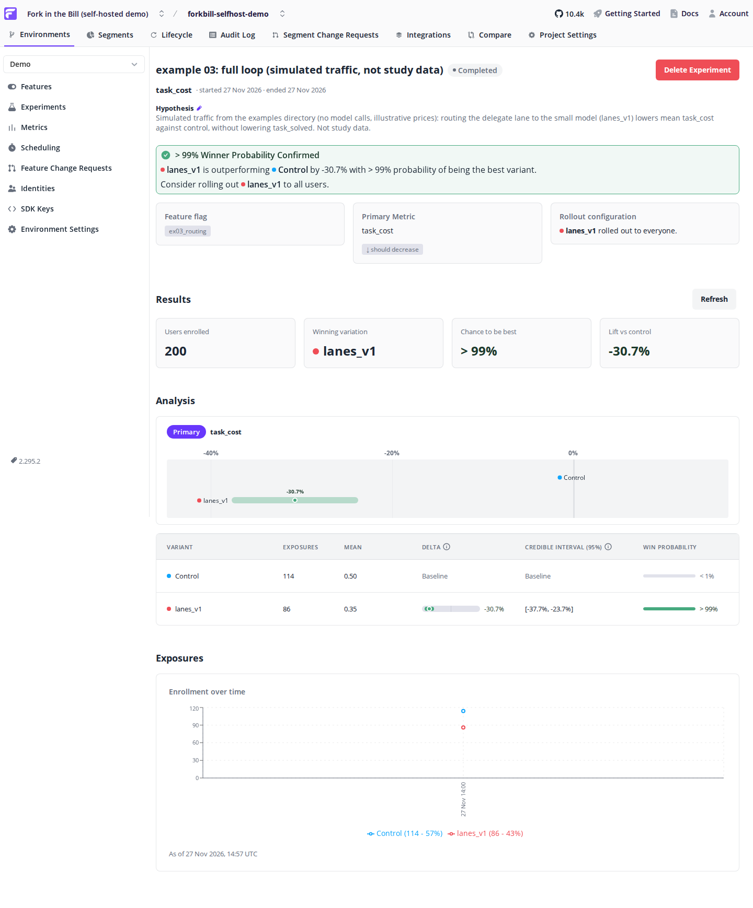
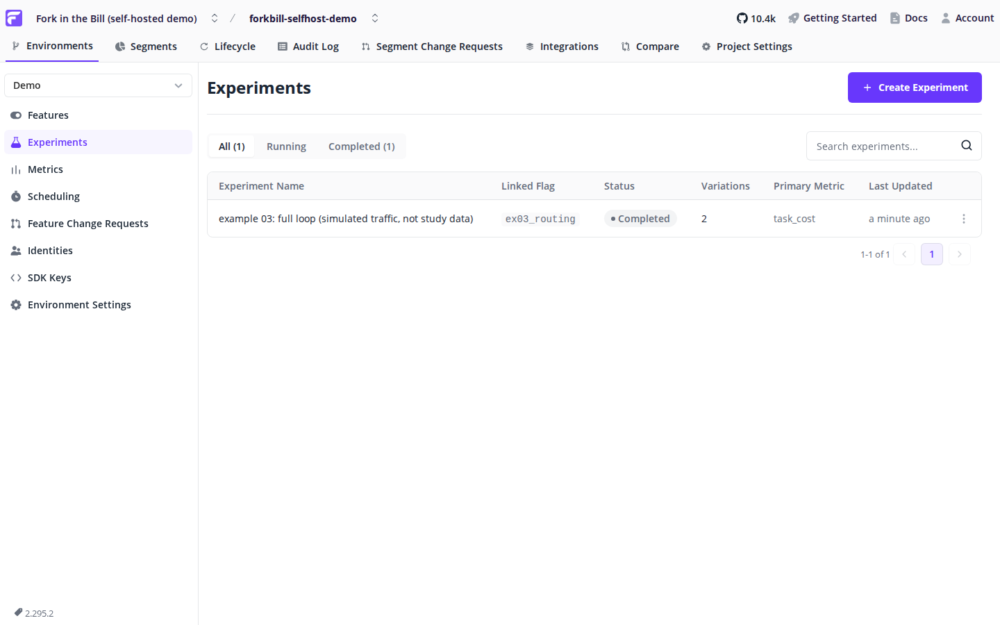

# 03: the full experiment on self-hosted Flagsmith

One script takes an empty Flagsmith from nothing to a finished experiment with the kit's CLI.
With `selfhost/bootstrap.sh` (about 90 seconds) and this script (20 seconds) the whole method
runs on one machine with no cloud account and no model key.

## Run it

```sh
selfhost/bootstrap.sh                            # once, see ../README.md
examples/03-full-experiment-selfhosted/run.sh    # about 20 seconds
```

The script uses its own flag, `ex03_routing`, and kill switch, `ex03_kill`. Ending its
experiment therefore leaves the experiment on `agent_routing`, which the other examples share,
running. To run it a second time on the same instance, give it new names:
`FLAG=ex03_routing_b KILL_FLAG=ex03_kill_b examples/03-full-experiment-selfhosted/run.sh`.

## What it does, step by step

The numbers below are from [`output/run.txt`](output/run.txt).

1. `forkbill init --flag ... --control ... --variant lanes_v1=... --metrics ... --hypothesis-file ... --start`
   creates the flag with the control policy as its value, the keyed variant `lanes_v1`, the kill
   switch, the four metrics and a 50/50 experiment at 100% rollout, and starts it. It prints
   the ids it created.
2. The experiment is read back from the Admin API: status `running`, the hypothesis text, the
   split and the four metrics with their directions.
3. `forkbill demo --n 200` runs 200 simulated identities through the Python SDK. Flagsmith
   served `control` to 114 and `lanes_v1` to 86. The script then counts the rows Flagsmith
   stored for them: 893, which is 200 exposures and 693 task events.
4. The exposures and results refreshes are requested (`HTTP/1.1 202 Accepted` twice) and the
   script waits for the task processor.
5. Flagsmith's exposures: `"new_identities":{"control":114,"lanes_v1":86}`.
6. Flagsmith's results, printed as returned and saved whole in
   [`output/flagsmith-results.json`](output/flagsmith-results.json).
7. The same results as a table:

   ```text
   metric        control n  control mean  lanes_v1 n  lanes_v1 mean  lift    95% interval      chance_to_win
   task_cost     114        0.5032        86          0.3486         -0.307  [-0.377, -0.237]  1
   task_solved   114        0.3509        86          0.6163         0.756   [0.226, 1.286]    0.997
   task_turns    114        13.0351       86          15.0698        0.156   [0.045, 0.268]    0.997
   task_seconds  114        126.9997      86          147.6887       0.163   [0.047, 0.279]    0.997
   ```

   Flagsmith's per-arm means equal the kit's own (`cost_mean` 0.5032 and 0.3486 in step 3).
8. The decision rule is applied to Flagsmith's numbers.
9. The experiment is ended with that decision:
   `flagsmith api <experiment>/complete/ -X POST -F rollout_decision=variant -F rollout_variant=1`.
   Flagsmith answers with status `completed`.
10. The flag is read again. Its own value is still the control policy, the experiment's segment
    override is gone, and `lanes_v1` now has weight 100. Five new identities read through the
    SDK all get the `lanes_v1` policy, with `flag_source=flag` and no exposure.

## The decision rule

Roll out `lanes_v1` when Flagsmith's `chance_to_win` on `task_cost` is at least 0.95 and its
`chance_to_win` on `task_solved` is at least 0.05; otherwise keep control. It is a two-line
stand-in for the study's registered rule ([`prereg/experiment-1.md`](../../prereg/experiment-1.md)),
written into `run.sh` before the first run. Here Flagsmith reported 1.0 and 0.997.

## The dashboard

Flagsmith's own results page for this experiment, from the same instance a minute later:





## Two things this run showed about the Admin API

`rollout_decision` takes `control`, `variant` or `disable`. A variant's key is rejected
(`"lanes_v1" is not a valid choice.`); the variant to roll out goes in `rollout_variant` as its
numeric id.

Ending an experiment with a variant does not copy the variant's value into the flag's own
value. Flagsmith sets that variant's weight to 100 on the environment default and removes the
experiment's override, which serves the winner to everyone all the same.

## What is simulated

The 200 tasks. `forkbill demo` is the kit's deterministic fake agent loop: no model is called
and the prices are illustrative. In that loop a task that reaches the policy's dollar cap counts
as unsolved, and control, whose delegate lane is on the dearer model, reaches the cap more often.
That is why `task_solved` differs so much between the arms here. It says nothing about real
routing; the study's result is in the [main README](../../README.md#results).

The split of 114 to 86 is what Flagsmith's hashing gave these 200 identities. A chi-square test
against 50/50 gives p of about 0.05, and Flagsmith's own `srm_p_value` was `null` in this
response.
